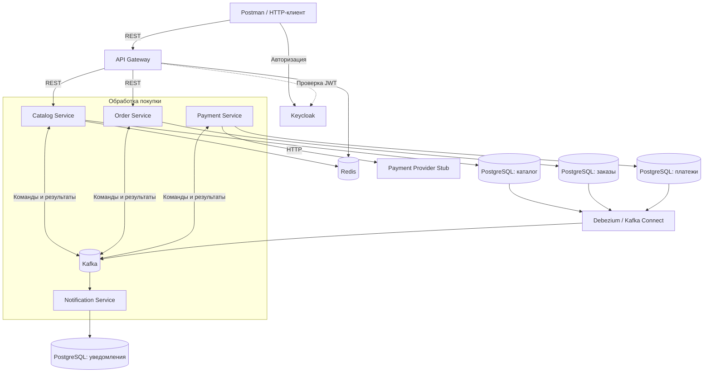

# Ticket Craft

Ticket Craft — демонстрационный backend-проект бронирования и покупки билетов. Проект показывает полный сценарий покупки в микросервисной архитектуре: выбор билета, резервирование, оплату и подтверждение заказа.

Всё окружение запускается через Docker Compose, включая платёжный эмулятор и загрузку demo-данных.

## Архитектура

Клиент обращается к сервисам через API Gateway. Каталог доступен без авторизации, операции с заказами защищены JWT, выдаваемыми Keycloak.

Order Service управляет процессом покупки. Взаимодействие между бизнес-сервисами асинхронное, через Kafka. Исходящие события сохраняются в PostgreSQL вместе с бизнес-изменениями и публикуются через Debezium и Kafka Connect.



На схеме связи сервисов с Kafka показывают логическое взаимодействие.
Исходящие бизнес-сообщения Catalog, Order и Payment публикуются через PostgreSQL и Debezium.

Каждый бизнес-сервис владеет отдельной базой данных.
Метрики собираются Prometheus и отображаются в Grafana, распределённые трассы доступны в Jaeger.

### Сервисы

| Сервис | Назначение | HTTP-порт |
|---|---|---|
| `api-gateway` | Единая точка входа, проверка JWT, rate limiting и Circuit Breaker | `8080` |
| `catalog-service` | Мероприятия, билеты, резервирование и подтверждение продажи | `8081` |
| `order-service` | Создание заказов и управление процессом покупки | `8082` |
| `notification-service` | Обработка подтверждённых заказов; уведомление имитируется записью в лог | `8083` |
| `payment-service` | Проведение оплаты и возвратов через платёжного провайдера | `8084` |
| `payment-provider-stub` | Эмулятор платёжного провайдера для demo-сценария | `8090` |

`common-dto` — общая Maven-библиотека контрактов, отдельный контейнер для неё не нужен.

### Стек технологий

- **Java 21**, **Spring Boot 4.1.1**, Maven Wrapper.
- Spring MVC, Spring Cloud Gateway / WebFlux.
- Spring Security, OAuth2 / OpenID Connect, JWT, Keycloak.
- PostgreSQL 16, Spring Data JPA / JDBC, Flyway.
- Apache Kafka, Spring Kafka, Kafka Connect, Debezium.
- Redis, Resilience4j.
- Spring Boot Actuator, Micrometer, OpenTelemetry, Prometheus, Grafana, Jaeger.
- JUnit, Mockito, Testcontainers, Embedded Kafka.
- Docker и Docker Compose.

## Системные требования

Для запуска всего проекта:

- Git.
- Docker с поддержкой Linux-контейнеров.
- Docker Compose **2.20.3 или новее** — используется `include`.
- Доступ к реестрам Docker-образов и Maven-зависимостям при первой сборке.
- Postman для проверки авторизации и покупки.

**Устанавливать JDK и Maven для запуска через Docker не требуется.**
Java-сервисы собираются внутри Docker, платёжный эмулятор запускается из готового JAR в репозитории.

Для сборки и запуска тестов на компьютере нужен **JDK 21**.
Отдельная установка Maven не требуется: в репозитории есть Maven Wrapper.

Команды ниже приведены для **PowerShell** и выполняются из корня репозитория.

## Быстрый старт

```powershell
git clone https://github.com/sergeykremnev8888/ticket-craft.git
Set-Location ticket-craft
Copy-Item .env.example .env
docker compose up -d --build
```

При первом запуске Docker скачает образы и соберёт приложения.
Запуск может занять несколько минут.

Compose автоматически:

- запускает инфраструктуру и Java-сервисы;
- создаёт схемы БД через Flyway;
- импортирует realm и demo-пользователя Keycloak;
- формирует подключения pgAdmin;
- регистрирует три Debezium-коннектора;
- загружает demo-мероприятие и десять билетов;
- запускает платёжный эмулятор.

Регистрировать коннекторы или выполнять SQL вручную не нужно.

### Проверка запуска

```powershell
docker compose ps -a
```

Ожидаемый результат:

- пять Java-сервисов имеют статус `healthy`;
- платёжный эмулятор и инфраструктура работают;
- `pgadmin-config`, `catalog-demo-data` и три контейнера `register-*-outbox`
  завершились с кодом `Exited (0)`.

Завершение этих пяти контейнеров с кодом `0` — нормальное поведение:
они выполняют одноразовую настройку.

Для просмотра результатов настройки:

```powershell
docker compose logs `
    pgadmin-config catalog-demo-data `
    register-catalog-outbox register-order-outbox register-payment-outbox
```

В логах регистрации коннекторов ожидаются `connector=RUNNING`,
`tasks=RUNNING` и `registration completed`.

### Настройки окружения

Файл `.env.example` содержит настройки для запуска всего проекта в Docker.
Скопируйте его в `.env` перед первым запуском.

Для стандартного demo-сценария менять адреса подключений не требуется.
Контейнеры обращаются друг к другу по именам сервисов Docker Compose.

Учётные данные demo-пользователя задаются переменными:

```dotenv
KEYCLOAK_DEMO_USERNAME=dev-user
KEYCLOAK_DEMO_PASSWORD=dev-user
```

Платёжный провайдер по умолчанию доступен внутри Docker-сети по адресу:

```dotenv
PAYMENT_PROVIDER_BASE_URL=http://payment-provider-stub:8090
```

## Проверка работоспособности

### 1. Посмотреть каталог

```powershell
curl.exe -i http://localhost:8080/api/v1/catalog/events

curl.exe -i http://localhost:8080/api/v1/catalog/events/11111111-1111-1111-1111-111111111111
```

Оба запроса должны вернуть `200 OK`.

На чистом окружении доступны:

- мероприятие `TicketCraft Demo Event`;
- десять билетов со статусом `AVAILABLE`;
- цена каждого билета — `1500`.

Билет для первой покупки:

```text
22222222-2222-2222-2222-222222222222
```

### 2. Получить токен в Postman

В разделе **Authorization** выберите **OAuth 2.0**
и настройте получение токена:

| Параметр | Значение |
|---|---|
| Grant Type | Authorization Code (With PKCE) |
| Callback URL | `https://oauth.pstmn.io/v1/browser-callback` |
| Authorize using browser | Включено |
| Auth URL | `http://localhost:9000/realms/ticketcraft/protocol/openid-connect/auth` |
| Access Token URL | `http://localhost:9000/realms/ticketcraft/protocol/openid-connect/token` |
| Client ID | `ticketcraft-postman` |
| Client Secret | Не требуется |
| Code Challenge Method | SHA-256 / S256 |
| Scope | `openid orders.write orders.read` |

Нажмите **Get New Access Token** и войдите пользователем из `.env`.
После получения токена нажмите **Use Token**.

Используйте **Access Token** в заголовке `Authorization: Bearer ...`.

После удаления volumes и повторного создания Keycloak получите новый токен.

### 3. Создать заказ

В Postman выполните:

```http
POST http://localhost:8080/api/v1/orders
Authorization: Bearer <access_token>
Content-Type: application/json
Idempotency-Key: demo-order-001
```

Тело запроса:

```json
{
  "ticketId": "22222222-2222-2222-2222-222222222222"
}
```

Ожидаемый HTTP-статус — `201 Created`.
Сохраните `id` из ответа.

Создание заказа запускает асинхронный процесс покупки:
первый ответ ещё не обязан содержать финальный статус.

### 4. Проверить результат покупки

С тем же токеном выполните:

```http
GET http://localhost:8080/api/v1/orders/<id>
Authorization: Bearer <access_token>
```

Повторите запрос через несколько секунд.
При успешном сценарии заказ перейдёт в статус **`CONFIRMED`**.

Повторно запросите мероприятие:

```powershell
curl.exe -i http://localhost:8080/api/v1/catalog/events/11111111-1111-1111-1111-111111111111
```

Купленный билет должен иметь статус **`SOLD`**.

Для следующей покупки выберите другой билет со статусом `AVAILABLE`
и новый `Idempotency-Key`.
Повторная отправка того же запроса с прежним ключом предназначена
для проверки идемпотентности.

### HTTP API

Все клиентские запросы отправляются через Gateway.

| Метод | Путь | Назначение | Авторизация |
|---|---|---|---|
| `GET` | `/api/v1/catalog/events` | Список мероприятий | Не требуется |
| `GET` | `/api/v1/catalog/events/{eventId}` | Мероприятие и билеты | Не требуется |
| `POST` | `/api/v1/orders` | Создание заказа | JWT, scope `orders.write` |
| `GET` | `/api/v1/orders/{orderId}` | Просмотр своего заказа | JWT, scope `orders.read` |

Для создания заказа обязателен заголовок `Idempotency-Key`.

## Интерфейсы и мониторинг

| Компонент | Адрес | Назначение |
|---|---|---|
| API Gateway | [localhost:8080](http://localhost:8080) | Входная точка HTTP API |
| Keycloak | [localhost:9000](http://localhost:9000) | Пользователи и авторизация |
| Kafka UI | [localhost:8070](http://localhost:8070) | Просмотр Kafka |
| Kafka Connect | [localhost:8085/connectors](http://localhost:8085/connectors) | Список CDC-коннекторов |
| pgAdmin | [localhost:5050](http://localhost:5050) | Работа с PostgreSQL |
| Prometheus | [localhost:9090](http://localhost:9090) | Метрики |
| Prometheus Targets | [localhost:9090/targets](http://localhost:9090/targets) | Состояние сбора метрик |
| Grafana | [localhost:3000](http://localhost:3000) | Дашборды и исследование метрик |
| Jaeger | [localhost:16686](http://localhost:16686) | Распределённые трассы |

В Prometheus проверьте, что targets пяти Java-сервисов имеют состояние `UP`.
После покупки найдите трассы обработки запросов в Jaeger.

Учётные данные Grafana и pgAdmin задаются в `.env`.
Администратор Keycloak для локального окружения — `admin` / `admin`.

Swagger UI / OpenAPI в текущей версии не подключены.
Основные запросы приведены выше, подробности — в README сервисов.

Порты PostgreSQL на компьютере:
каталог — `5432`, заказы — `5433`, уведомления — `5434`, платежи — `5435`.
Kafka доступна на `localhost:9092`, Redis — на `localhost:6379`.

## Демонстрируемые паттерны и возможности

| Возможность | Что показывает проект |
|---|---|
| Database per Service | Каждый бизнес-сервис владеет своей PostgreSQL-базой |
| Saga | Order Service управляет покупкой и компенсационными действиями при неуспешном выполнении |
| Transactional Outbox и CDC | Бизнес-изменения и исходящие события сохраняются одной транзакцией; публикация выполняется через Debezium |
| Идемпотентность | Защита от повторного создания заказа и повторной обработки сообщений |
| Конкурентное резервирование | Согласованное изменение состояния билета на стороне PostgreSQL |
| Асинхронное взаимодействие | Процесс покупки распределён между сервисами через Kafka |
| Retry и Dead Letter Queue | Повторная обработка временных ошибок и изоляция проблемных сообщений |
| Circuit Breaker и таймауты | Ограничение влияния сбоев downstream-сервисов в Gateway |
| Rate limiting | Ограничение частоты запросов с использованием Redis |
| OAuth2 / JWT | Авторизация через Keycloak, проверка scopes и принадлежности заказа пользователю |
| Кеширование | Redis-кеш каталога мероприятий |
| Observability | Метрики, корреляция запросов и распределённая трассировка |
| Автоматизация окружения | Миграции, demo-данные и регистрация CDC-коннекторов через Docker Compose |

## Сборка и тесты

Для выполнения команд на компьютере нужны JDK 21 и работающий Docker.
Интеграционные тесты используют Testcontainers; часть Kafka-тестов — Embedded Kafka.

Запуск тестов всего проекта:

```powershell
.\mvnw.cmd clean test
```

Сборка всех Maven-модулей с тестами:

```powershell
.\mvnw.cmd clean package
```

При обычном запуске через Docker Compose предварительная локальная сборка не нужна.

## Управление окружением

Повторный запуск:

```powershell
docker compose up -d
```

Пересборка после изменения исходников или JAR эмулятора:

```powershell
docker compose up -d --build
```

Просмотр логов:

```powershell
docker compose logs --tail 100 api-gateway order-service payment-service
```

Остановка с сохранением данных:

```powershell
docker compose stop
```

Удаление контейнеров с сохранением volumes:

```powershell
docker compose down
```

Полный сброс и запуск с нуля:

```powershell
docker compose down --volumes --remove-orphans
docker compose up -d --build
```

**Полный сброс удаляет данные БД, заказы, Kafka и данные Keycloak.**
После него demo-данные создаются заново, а токен нужно получить повторно.

Обычный перезапуск не возвращает проданные билеты в состояние `AVAILABLE`.

### Только инфраструктура

Для разработки с Java-сервисами на компьютере инфраструктуру можно запустить отдельно:

```powershell
docker compose -f docker-compose.infra.yml up -d --build
```

Этот режим не запускает бизнес-сервисы, платёжный эмулятор,
загрузку demo-данных и регистрацию CDC-коннекторов.

Настройка локального запуска описана в README соответствующих сервисов.
Для первой проверки полного сценария используйте основной запуск через
`docker compose up -d --build`.

## Документация модулей

- [API Gateway](api-gateway/README.md)
- [Catalog Service](catalog-service/README.md)
- [Order Service](order-service/README.md)
- [Payment Service](payment-service/README.md)
- [Notification Service](notification-service/README.md)
- [Common DTO](common-dto/README.md)

## Ограничения demo-версии

- Оплата выполняется эмулятором, реальные списания не производятся.
- Уведомления имитируются записью в лог; отправка email, SMS и push не реализована.
- Автоматическое восстановление всех зависших Saga и повторная обработка DLT
  требуют дальнейшего развития.
- Окружение рассчитано на локальную демонстрацию:
  используется один Kafka broker и development-режим Keycloak.
