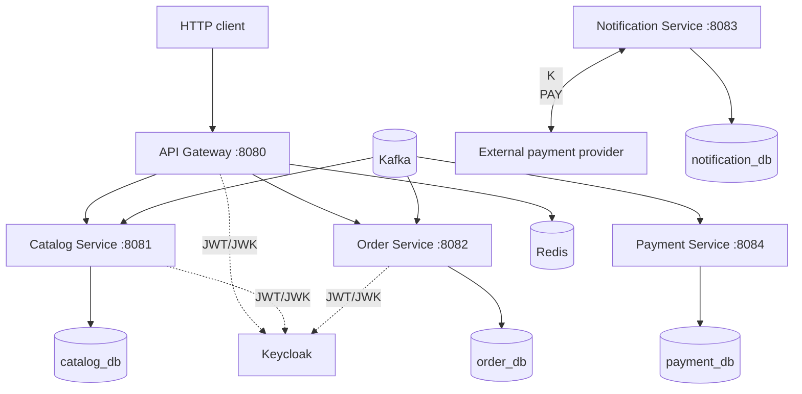

# Ticket Craft

**Ticket Craft** — backend-проект системы бронирования и покупки билетов на **Java 21 / Spring Boot 4**. Проект предназначен для практического изучения микросервисной архитектуры, распределённых систем, согласованности данных и конкурентного резервирования.
- **Database per Service:** четыре отдельные PostgreSQL-базы для каталога, заказов, платежей и уведомлений.
- **Асинхронная Saga:** заказ проходит резервирование билета, оплату и подтверждение; для неуспешных сценариев предусмотрены компенсационные команды.
- **Transactional Outbox:** бизнес-изменения и исходящие события фиксируются в одной транзакции БД.
- **Конкурентное бронирование:** атомарное изменение состояния билета на стороне PostgreSQL, защита от повторных команд.
- **Идемпотентность:** `Idempotency-Key` для создания заказов, персистентный учёт обработанных событий у отдельных Kafka consumers.
- **Security:** Keycloak, JWT/OAuth2 Resource Server, проверка scopes и владельца заказа.
- **Resilience и observability:** rate limiting с использованием Redis, Circuit Breaker в Gateway, Actuator, Prometheus, Grafana и OpenTelemetry/Jaeger.

## Архитектура


Связи Kafka → сервис обозначают получение бизнес-команд и результатов. Исходящие бизнес-сообщения идут через outbox PostgreSQL и Debezium. Публикация ошибок в DLT в Java-приложениях.

Связи JWT/JWK обозначают использование Keycloak и его ключей для проверки токенов.

`docker-compose.yml` запускает инфраструктуру и пять Java-приложений с профилем `apps`. Сборка и запуск приложений выполняются в Docker. `common-dto` — Maven-библиотека, отдельный контейнер ей не нужен.

## Модули и подробная документация

| Модуль | Назначение | README |
|---|---|---|
| `api-gateway` | Маршрутизация, JWT, Redis rate limiting, Circuit Breaker | [Документация](api-gateway/README.md) |
| `catalog-service` | Каталог мероприятий, билеты, резервирование и подтверждение | [Документация](catalog-service/README.md) |
| `order-service` | HTTP API заказов, идемпотентность, оркестрация Saga | [Документация](order-service/README.md) |
| `payment-service` | Обработка запросов оплаты и возврата через внешний платежный провайдер | [Документация](payment-service/README.md) |
| `notification-service` | Обработка событий подтверждённых заказов | [Документация](notification-service/README.md) |
| `common-dto` | Общие контракты Kafka-сообщений и состояния | [Документация](common-dto/README.md) |

## Границы ответственности

Order Service отвечает за:
- принадлежность заказа пользователю;
- состояние заказа;
- состояние Saga;
- выбор следующего шага Saga;
- сохранение исходящих команд и событий;
- обработку результатов Catalog Service и Payment Service.

Catalog Service отвечает за доступность билета, резервирование, срок действия резерва и подтверждение продажи.

Payment Service отвечает за взаимодействие с платёжным провайдером, результат оплаты и возврат денег.

Notification Service получает событие подтверждённого заказа. Его обработка не является условием завершения Saga покупки.

## Стек

Java 21, Spring Boot 4.1.1, Spring MVC, Spring Cloud Gateway (WebFlux), Spring Security, Spring Data JPA/JDBC, Spring Kafka, PostgreSQL 16, Flyway, Apache Kafka, Redis, Keycloak, Maven, Docker Compose, JUnit/Mockito, Spring Boot Actuator, Micrometer, Prometheus, Grafana, OpenTelemetry/Jaeger.

## Запуск через Docker (Windows / PowerShell)

Для запуска пяти сервисов нужны Docker с Docker Compose v2 и доступ к реестрам образов и Maven-зависимостям. JDK и Maven на компьютере не требуются: сборка выполняется внутри multi-stage Dockerfile. Все команды ниже выполняются из корня репозитория.

### 1. Настроить окружение

Создайте локальный `.env` рядом с `docker-compose.yml`, например:

```dotenv
CATALOG_DB_NAME=catalog_db
CATALOG_DB_USERNAME=catalog_user
CATALOG_DB_PASSWORD=local_catalog_password
ORDER_DB_NAME=order_db
ORDER_DB_USERNAME=order_user
ORDER_DB_PASSWORD=local_order_password
PAYMENT_DB_NAME=payment_db
PAYMENT_DB_USERNAME=payment_user
PAYMENT_DB_PASSWORD=local_payment_password
NOTIFICATION_DB_NAME=notification_db
NOTIFICATION_DB_USERNAME=notification_user
NOTIFICATION_DB_PASSWORD=local_notification_password
PGADMIN_EMAIL=admin@example.com
PGADMIN_PASSWORD=local_pgadmin_password
GRAFANA_ADMIN_USER=admin
GRAFANA_ADMIN_PASSWORD=local_grafana_password
PAYMENT_PROVIDER_DOCKER_URL=http://host.docker.internal:8090
```

Указанные имена баз и пользователей должны остаться как в примере: на них рассчитаны Docker-профили, PostgreSQL healthchecks и конфигурации CDC.
При существующих PostgreSQL volumes используйте их действующие учётные данные: изменение `.env` не меняет пароль уже созданной базы.

Compose передаёт необходимые параметры приложениям и включает Spring-профиль `docker`.
Адреса PostgreSQL, Kafka, Redis и Jaeger внутри Docker-сети уже заданы в `application-docker.yml`.
Обычный `docker compose up -d` запускает инфраструктуру; Compose-профиль `apps` дополнительно включает пять приложений.

### 2. Подготовить платёжный провайдер

Внешний payment provider **не входит в репозиторий и Compose**. Для покупки до `CONFIRMED` нужен работающий провайдер, совместимый с [HTTP-контрактом Payment Service](payment-service/README.md).

Укажите доступный из контейнера URL в `PAYMENT_PROVIDER_DOCKER_URL`.
Значение по умолчанию `http://host.docker.internal:8090` обращается к провайдеру через опубликованный порт компьютера; оно подходит и для отдельно запущенного контейнера провайдера с опубликованным портом `8090`.
`localhost` внутри Payment Service указывает на сам Payment Service.

Готового образа и команды сборки провайдера в этом репозитории пока нет. Запуск пяти приложений выполняется полностью через Docker, но полный платёжный сценарий требует этой внешней зависимости.

### 3. Собрать и запустить контейнеры

```powershell
docker compose --profile apps config --quiet
docker compose --profile apps build
docker compose up -d
docker compose ps
```

Дождитесь готовности PostgreSQL, Kafka и Kafka Connect:

```powershell
Invoke-RestMethod -Uri "http://localhost:8085/connectors"
```

Затем запустите приложения:

```powershell
docker compose --profile apps up -d
docker compose --profile apps ps
docker compose logs --tail 100 api-gateway catalog-service order-service payment-service notification-service
```

При первом старте Flyway создаёт схемы. Дождитесь успешного запуска всех приложений.

**На чистом окружении до регистрации CDC-коннекторов не создавайте заказы и не отправляйте бизнес-команды в Kafka.** Следующий шаг рассчитан на новые базы и отсутствие накопленных команд. Если в Kafka уже есть необработанные сообщения, миграции и запуск consumers нужно разделить: простой запуск приложений может обработать команды до создания replication slots.

### 4. Зарегистрировать CDC-коннекторы при первом запуске

Kafka Connect не регистрирует коннекторы автоматически. После применения миграций выполните в PowerShell:

```powershell
$ErrorActionPreference = "Stop"

$connectors = @(
    @{ Name = "order-outbox"; Service = "order-service"; Prefix = "ORDER" },
    @{ Name = "catalog-outbox"; Service = "catalog-service"; Prefix = "CATALOG" },
    @{ Name = "payment-outbox"; Service = "payment-service"; Prefix = "PAYMENT" }
)

foreach ($connector in $connectors) {
    $config = Get-Content -Raw "./docker/kafka-connect/$($connector.Name).json" |
        ConvertFrom-Json
    $serviceEnvironment = docker compose --profile apps run --rm --no-deps --entrypoint printenv $connector.Service
    if ($LASTEXITCODE -ne 0) {
        throw "Cannot read environment for $($connector.Service)"
    }

    foreach ($setting in @("USERNAME", "PASSWORD")) {
        $variableName = "$($connector.Prefix)_DB_$setting"
        $line = $serviceEnvironment |
            Where-Object { $_.StartsWith("$variableName=") } |
            Select-Object -First 1
        if (-not $line) {
            throw "Missing $variableName"
        }
        $property = if ($setting -eq "USERNAME") { "database.user" } else { "database.password" }
        $config.$property = $line.Substring($variableName.Length + 1)
    }

    $config.PSObject.Properties.Remove("name")
    $body = $config | ConvertTo-Json -Depth 10
    Invoke-RestMethod -Method Put `
        -Uri "http://localhost:8085/connectors/$($connector.Name)/config" `
        -ContentType "application/json" -Body $body | Out-Null
}
```

Скрипт подставляет учётные данные из окружения Compose в REST-запрос, не меняя JSON-файлы в репозитории. Не выводите `$serviceEnvironment` или `$body`: они содержат пароли.

Проверьте каждый connector и его task:

```powershell
foreach ($name in @("order-outbox", "catalog-outbox", "payment-outbox")) {
    Invoke-RestMethod -Uri "http://localhost:8085/connectors/$name/status" |
        ConvertTo-Json -Depth 10
}
```

У всех ожидается `RUNNING`, включая task. При `FAILED` сначала устраните причину по полю `trace` и логам `docker compose logs --tail 100 kafka-connect`.
Healthy Kafka Connect сам по себе не подтверждает готовность коннекторов.

Для дополнительной проверки slots:

```powershell
docker compose exec -T postgres-order psql -U order_user -d order_db -c "SELECT slot_name, active FROM pg_replication_slots;"
docker compose exec -T postgres-catalog psql -U catalog_user -d catalog_db -c "SELECT slot_name, active FROM pg_replication_slots;"
docker compose exec -T postgres-payment psql -U payment_user -d payment_db -c "SELECT slot_name, active FROM pg_replication_slots;"
```

Ожидаются соответствующие `ticketcraft_*_outbox` с `active = t`.
Коннекторы используют `snapshot.mode=no_data`: ранее записанные строки outbox не публикуются начальным сканированием.
При обычном перезапуске повторная регистрация не требуется, если сохранились конфигурация, offsets, slots и WAL.

### 5. Добавить демонстрационный билет

В Docker-профиле автоматический SQL seed отключён. На новой базе выполните:

```powershell
Get-Content -Raw "./catalog-service/src/main/resources/db/local/seed.sql" |
    docker compose exec -T postgres-catalog psql -v ON_ERROR_STOP=1 -U catalog_user -d catalog_db
```

Seed добавляет мероприятие `11111111-1111-1111-1111-111111111111` и билет `22222222-2222-2222-2222-222222222222`.
Повторный запуск не сбрасывает состояние уже существующего билета. Для повторной покупки нужен другой доступный билет.
Список мероприятий может обновиться после истечения кеша Catalog (по умолчанию 5 минут).

### 6. Проверить работу

```powershell
curl.exe -i http://localhost:8080/api/v1/catalog/events
curl.exe -i http://localhost:8080/api/v1/catalog/events/11111111-1111-1111-1111-111111111111
```

Каталог доступен без токена. Для создания и чтения заказа получите access token через Keycloak в Postman: realm `ticketcraft`, client `ticketcraft-postman`, пользователь `e2e-user`. Настройка OAuth2 описана в [README Gateway](api-gateway/README.md). Запросите scopes `openid orders.write orders.read`; клиент использует Authorization Code с PKCE S256, callback — `https://oauth.pstmn.io/v1/browser-callback`.
Используйте issuer `http://localhost:9000/realms/ticketcraft`: он должен совпадать с `iss` токена. В контейнерах JWK Set доступен по `http://keycloak:8080/realms/ticketcraft/protocol/openid-connect/certs`.

Создайте заказ через Gateway с Bearer-токеном, новым `Idempotency-Key` и JSON `{"ticketId":"22222222-2222-2222-2222-222222222222"}`.
Запрашивайте `GET /api/v1/orders/{orderId}` с действующим токеном того же пользователя до завершения покупки. Успешный результат — `CONFIRMED`.
При `401` проверьте срок действия токена; для GET также нужен заголовок Authorization.

Проверьте пять targets со статусом `UP` в Prometheus и новые трассы в Jaeger.
В Grafana выберите Explore → Jaeger и найдите трассу по trace ID из лога приложения или URL открытой трассы в Jaeger.
`X-Correlation-ID` — отдельный идентификатор, он не заменяет trace ID.

В текущем окружении вручную проверены каталог через Gateway, пять Prometheus targets `UP` и покупка до `CONFIRMED` при работающем внешнем провайдере. Полный bootstrap с пустыми volumes по этой инструкции отдельно не проверялся.

### Повторный запуск, обновление и остановка

Обычный запуск подготовленного окружения:

```powershell
docker compose --profile apps up -d
```

После изменения исходников или `application-docker.yml`:

```powershell
docker compose --profile apps up -d --build
```

После изменения конфигурации Prometheus или provisioning Grafana:

```powershell
docker compose restart prometheus grafana
```

Остановить контейнеры с сохранением данных и конфигурации:

```powershell
docker compose --profile apps stop
```

Kafka хранит данные в `ticketcraft_kafka_data`, Keycloak — в `ticketcraft_keycloak_data`. Они сохраняются при пересоздании контейнеров и `docker compose down` без `-v`.
Для обычной работы можно использовать `stop`/`start` или `up -d`. Не используйте `down -v` для обычного перезапуска: эта команда удаляет volumes с данными.

Пять Java-приложений имеют healthcheck на `/actuator/health`. Gateway при запуске ожидает `healthy` у Catalog и Order. Это проверка состояния приложения и включённых Actuator-индикаторов; она не проверяет регистрацию CDC-коннекторов и успешность покупки. Статус `unhealthy` сам по себе не перезапускает контейнер.

### Переход с Compose без volumes Kafka и Keycloak

Этот раздел нужен один раз при обновлении старого окружения. Для нового окружения выполните обычный первый запуск выше.
**До первого `up` с новым Compose сохраните текущую БД Keycloak**, если в ней есть нужные пользователи, клиенты или изменения realm.
Новый Kafka volume намеренно запускается пустым: перенос старой истории Kafka в этом обновлении не выполняется.

Остановите приложения и инфраструктуру без удаления контейнеров:

```powershell
docker compose --profile apps stop
```

Скопируйте БД из остановленного Keycloak (версия образа остаётся `26.7.3`):

```powershell
$keycloakContainer = docker compose ps -a -q keycloak
if ($LASTEXITCODE -ne 0 -or -not $keycloakContainer) {
    throw "Existing Keycloak container not found; do not recreate it before backup"
}

$keycloakBackup = Join-Path ([System.IO.Path]::GetTempPath()) ("ticketcraft-keycloak-" + [guid]::NewGuid().ToString())
New-Item -ItemType Directory -Path $keycloakBackup | Out-Null
docker cp "${keycloakContainer}:/opt/keycloak/data/h2/." $keycloakBackup
if ($LASTEXITCODE -ne 0) { throw "Keycloak backup failed" }

# Создайте volume и перенесите в него копию. Существующий h2 не перезаписывается.
docker volume create ticketcraft_keycloak_data
if ($LASTEXITCODE -ne 0) { throw "Cannot create Keycloak volume" }

docker run --rm --user 0 --entrypoint sh `
    --mount "type=bind,source=$keycloakBackup,target=/backup,readonly" `
    --mount "type=volume,source=ticketcraft_keycloak_data,target=/restore" `
    postgres:16-alpine -ec 'test ! -e /restore/h2; mkdir /restore/h2; cp -a /backup/. /restore/h2/; chown -R 1000:0 /restore'
if ($LASTEXITCODE -ne 0) { throw "Keycloak restore failed; do not start the updated environment" }
```

Временный контейнер PostgreSQL здесь используется только для копирования файлов; сервер БД в нём не запускается. UID/GID `1000:0` соответствуют образу Keycloak `26.7.3`.
Копия содержит данные аутентификации: сохраните путь `$keycloakBackup` и не публикуйте её. Если первая попытка переноса не завершилась успешно, не повторяйте команды поверх частично заполненного volume без проверки.

Если сохранять старый Keycloak не нужно, пропустите копирование: новый volume будет инициализирован через существующий `--import-realm`. Пользовательские изменения прежнего realm при этом не переносятся.

После сохранения Keycloak обновите образы и запустите окружение:

```powershell
docker compose --profile apps config --quiet
docker compose pull kafka-ui pgadmin
docker compose --profile apps build
docker compose --profile apps up -d
docker compose --profile apps ps
```

Дождитесь `healthy` у пяти приложений. При ошибке проверьте логи соответствующего сервиса.

После запуска пустой Kafka заново выполните регистрацию трёх коннекторов из шага 4 и проверьте `RUNNING` у connector/task. Не отправляйте новые заказы до готовности CDC.
Потеря истории Kafka включает бизнес-топики, consumer offsets и внутренние топики Kafka Connect. PostgreSQL volumes и существующие replication slots сохраняются. Это **не процедура восстановления старых Saga**: зависшие заказы, недоставленные сообщения и согласованность slots/offsets требуют отдельного разбора. Не удаляйте slots и не сбрасывайте offsets автоматически.

Проверьте вход в Keycloak, каталог, пять Prometheus targets `UP`, а затем создайте новый заказ на доступный билет с новым `Idempotency-Key` и дождитесь `CONFIRMED`.
Проверьте сохранение данных без очередного сброса Kafka:

```powershell
docker compose up -d --no-deps --force-recreate kafka
# Дождитесь healthy у Kafka; Connect после переподключения должен вернуть RUNNING.
docker compose up -d --no-deps --force-recreate keycloak
```

Повторно проверьте коннекторы, вход в Keycloak и чтение ранее созданного заказа. Входящие JWT могут потребовать обновления после перезапуска Keycloak.

Версии UI закреплены: Kafka UI `v0.7.2`, pgAdmin `9.18`. Перед обновлением pgAdmin из ранее скачанного `latest` проверьте его текущую версию в Help → About: если она новее `9.18`, не понижайте версию поверх существующего pgAdmin volume; закрепите уже используемую версию вместо этого.


### Адреса

| Компонент | Локальный адрес |
|---|---|
| API Gateway | `http://localhost:8080` |
| Catalog | `http://localhost:8081` |
| Order | `http://localhost:8082` |
| Notification (Actuator) | `http://localhost:8083` |
| Payment (Actuator) | `http://localhost:8084` |
| Kafka Connect REST API | `http://localhost:8085` |
| Keycloak | `http://localhost:9000` |
| Kafka UI | `http://localhost:8070` |
| pgAdmin | `http://localhost:5050` |
| Prometheus | `http://localhost:9090` |
| Grafana | `http://localhost:3000` |
| Jaeger UI | `http://localhost:16686` |

PostgreSQL: catalog `5432`, order `5433`, notification `5434`, payment `5435`; Kafka `9092`, Redis `6379`.

Compose передаёт параметры подключения контейнерам автоматически. Порты в таблице опубликованы для доступа с компьютера.

### HTTP API

| Метод | Путь через Gateway | Назначение |
|---|---|---|
| `GET` | `/api/v1/catalog/events` | Список мероприятий |
| `GET` | `/api/v1/catalog/events/{eventId}` | Мероприятие и билеты |
| `POST` | `/api/v1/orders` | Создание заказа (`JWT`, `Idempotency-Key`, JSON `{"ticketId":"<uuid>"}`) |
| `GET` | `/api/v1/orders/{orderId}` | Статус собственного заказа (`JWT`) |

## Известные ограничения

- Notification Service сейчас имитирует уведомление записью в лог: email, SMS и push не реализованы.
- Saga не имеет автоматического общего дедлайна. Отсутствующий результат или сообщение в DLT могут оставить её в ожидании.
- Payment выполняет немедленный запрос статуса после некоторых ошибок HTTP-вызова, но фоновая сверка неопределённых операций не реализована.
- Автоматическое восстановление Saga и повторная обработка DLT остаются в backlog.
- Это локальная демонстрационная инфраструктура (один Kafka broker, development-настройки Keycloak и наблюдаемости).
- Внешний payment provider требуется отдельно; без него полный успешный платёжный сценарий не воспроизводится.
- В Gateway остаются задачи по ограничению прямого доступа к `/fallback/**` и `/actuator/prometheus`. Диагностический маршрут Gateway включается только с профилем `local`. Аутентификация выполняется в Gateway, scopes и бизнес-авторизация — в соответствующем HTTP-сервисе.
- Совместимость форматов Kafka-событий при rolling deployment требует отдельного контроля: `TicketReservedEvent` с `eventId`/`price` несовместим со старым форматом. См. [Catalog](catalog-service/README.md) и [Order](order-service/README.md).
- Нагрузочные показатели, SLO и production readiness пока не заявлены.
