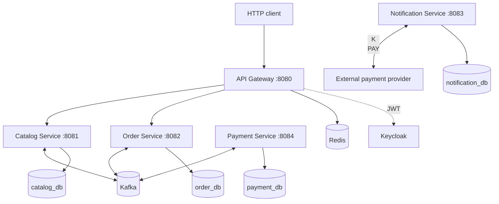

# Ticket Craft

**Ticket Craft** — учебный backend-проект системы бронирования и покупки билетов на **Java 21 / Spring Boot 4** для исследование на практике микросервисную архитектуру распределённых систем, согласованность данных, конкурентное резервирование.

## Что интересно с технической точки зрения

- **Database per Service:** четыре отдельные PostgreSQL-базы для каталога, заказов, платежей и уведомлений.
- **Асинхронная Saga:** заказ проходит резервирование билета, оплату и подтверждение; для неуспешных сценариев предусмотрены компенсационные команды.
- **Transactional Outbox:** бизнес-изменения и исходящие события фиксируются в одной транзакции БД, затем отдельный publisher отправляет сообщения в Kafka.
- **Конкурентное бронирование:** атомарное изменение состояния билета на стороне PostgreSQL, защита от повторных команд.
- **Идемпотентность:** `Idempotency-Key` для создания заказов, персистентный учёт обработанных событий у отдельных Kafka consumers.
- **Security:** Keycloak, JWT/OAuth2 Resource Server, проверка scopes и владельца заказа.
- **Resilience и observability:** rate limiting с использованием Redis, Circuit Breaker в Gateway, Actuator, Prometheus, Grafana и OpenTelemetry/Tempo.

## Архитектура



`docker-compose.yml` поднимает **инфраструктуру**, но не сами Java-приложения: их нужно запускать отдельно. `common-dto` — Maven-библиотека, а не сетевой сервис.

## Модули и подробная документация

| Модуль | Назначение | README |
|---|---|---|
| `api-gateway` | Маршрутизация, JWT, Redis rate limiting, Circuit Breaker | [Документация](api-gateway/README.md) |
| `catalog-service` | Каталог мероприятий, билеты, резервирование и подтверждение | [Документация](catalog-service/README.md) |
| `order-service` | HTTP API заказов, идемпотентность, оркестрация Saga | [Документация](order-service/README.md) |
| `payment-service` | Обработка запросов оплаты и возврата через внешний платежный провайдер | [Документация](payment-service/README.md) |
| `notification-service` | Обработка событий подтверждённых заказов | [Документация](notification-service/README.md) |
| `common-dto` | Общие контракты Kafka-сообщений и состояния | [Документация](common-dto/README.md) |

## Границы ответственности

Order Service отвечает за:

- принадлежность заказа пользователю;
- состояние заказа;
- состояние Saga;
- выбор следующего шага Saga;
- сохранение исходящих команд и событий;
- обработку результатов Catalog Service и Payment Service.

Catalog Service отвечает за доступность билета, резервирование, срок действия резерва и подтверждение продажи.

Payment Service отвечает за взаимодействие с платёжным провайдером, результат оплаты и возврат денег.

Notification Service получает событие подтверждённого заказа. Его обработка не является условием завершения Saga покупки.

Order Service не вызывает Catalog Service и Payment Service по HTTP: взаимодействие выполняется через Kafka.

## Стек

Java 21, Spring Boot 4.1.1, Spring MVC, Spring Cloud Gateway (WebFlux), Spring Security, Spring Data JPA/JDBC, Spring Kafka, PostgreSQL 16, Flyway, Apache Kafka, Redis, Keycloak, Maven, Docker Compose, JUnit/Mockito, Spring Boot Actuator, Micrometer, Prometheus, Grafana, OpenTelemetry/Tempo.

## Локальный запуск (Windows / PowerShell)

Требуются **JDK 21**, Docker с Docker Compose и доступ к Maven-зависимостям. Для payment-flow дополнительно нужен **внешний payment provider**, совместимый с контрактом `payment-service`; он **не включён** в `docker-compose.yml`.

```powershell
Copy-Item .env.example .env
# При необходимости отредактируйте .env

docker compose up -d
docker compose ps

.\mvnw.cmd clean install
```

После сборки запустите приложения **в отдельных терминалах PowerShell** из корня репозитория:

```powershell
.\mvnw.cmd -pl catalog-service spring-boot:run
.\mvnw.cmd -pl order-service spring-boot:run
.\mvnw.cmd -pl payment-service spring-boot:run
.\mvnw.cmd -pl notification-service spring-boot:run
.\mvnw.cmd -pl api-gateway spring-boot:run
```

Для локального окружения проверьте настройки `application-local.yml` каждого сервиса, параметры Keycloak и адрес payment provider. Запуск приложений и интеграционные сценарии **не проверялись** при подготовке этой документации.

| Компонент | Локальный адрес |
|---|---|
| API Gateway | `http://localhost:8080` |
| Catalog | `http://localhost:8081` |
| Order | `http://localhost:8082` |
| Notification (Actuator) | `http://localhost:8083` |
| Payment (Actuator) | `http://localhost:8084` |
| Keycloak | `http://localhost:9000` |
| Kafka UI | `http://localhost:8070` |
| pgAdmin | `http://localhost:5050` |
| Prometheus | `http://localhost:9090` |
| Grafana | `http://localhost:3000` |
| Tempo | `http://localhost:3200` |

PostgreSQL: catalog `5432`, order `5433`, notification `5434`, payment `5435`; Kafka `9092`, Redis `6379`. Значения и учётные данные задаются в `.env` (пример — `.env.example`).

### HTTP API

| Метод | Путь через Gateway | Назначение |
|---|---|---|
| `GET` | `/api/v1/catalog/events` | Список мероприятий |
| `GET` | `/api/v1/catalog/events/{eventId}` | Мероприятие и билеты |
| `POST` | `/api/v1/orders` | Создание заказа (`JWT`, `Idempotency-Key`, JSON `{"ticketId":"<uuid>"}`) |
| `GET` | `/api/v1/orders/{orderId}` | Статус собственного заказа (`JWT`) |

## Тесты и наблюдаемость

В проекте есть unit- и интеграционные тесты, в том числе для Saga, idempotency, outbox, резервирования и Kafka. Для отдельных интеграционных тестов требуется Docker/Testcontainers. Пример запуска:

```powershell
.\mvnw.cmd test
```

Метрики доступны через Actuator с учётом security-настроек конкретного сервиса. Конфигурации Prometheus, Grafana и Tempo находятся в `observability/`. Trace context через durable outbox **не сохраняется автоматически**: асинхронная публикация может начать новую трассу.

## Известные ограничения

- Это локальная демонстрационная инфраструктура (один Kafka broker, development-настройки Keycloak и наблюдаемости).
- Внешний payment provider требуется отдельно; без него полный успешный платёжный сценарий не воспроизводится.
- Gateway README фиксирует открытые задачи по защите диагностических маршрутов, метрик и согласованию авторизации `POST /api/v1/orders`.
- Совместимость форматов Kafka-событий при rolling deployment требует отдельного контроля: `TicketReservedEvent` с `eventId`/`price` несовместим со старым форматом. См. [Catalog](catalog-service/README.md) и [Order](order-service/README.md).
- Нагрузочные показатели, SLO и production readiness пока не заявлены.
