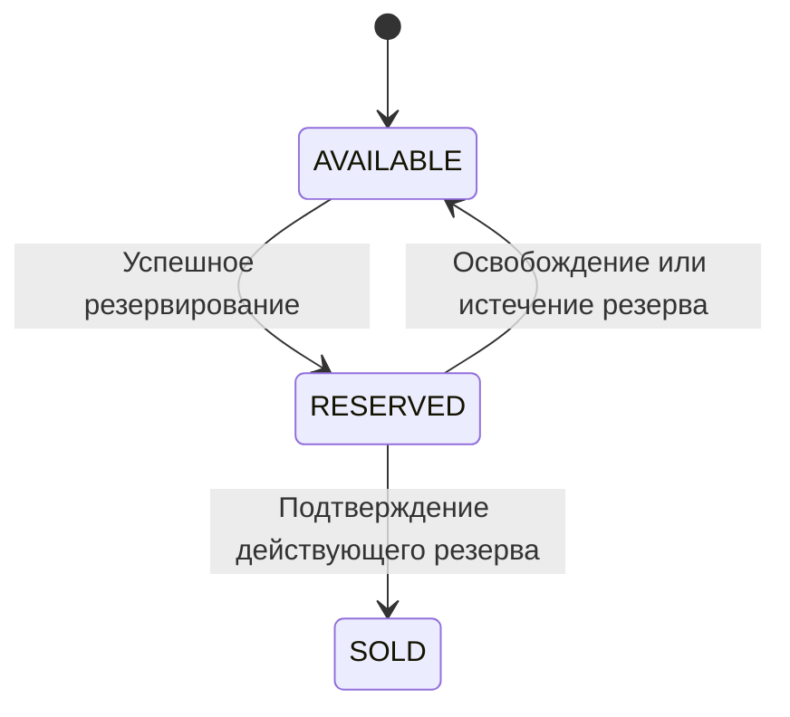
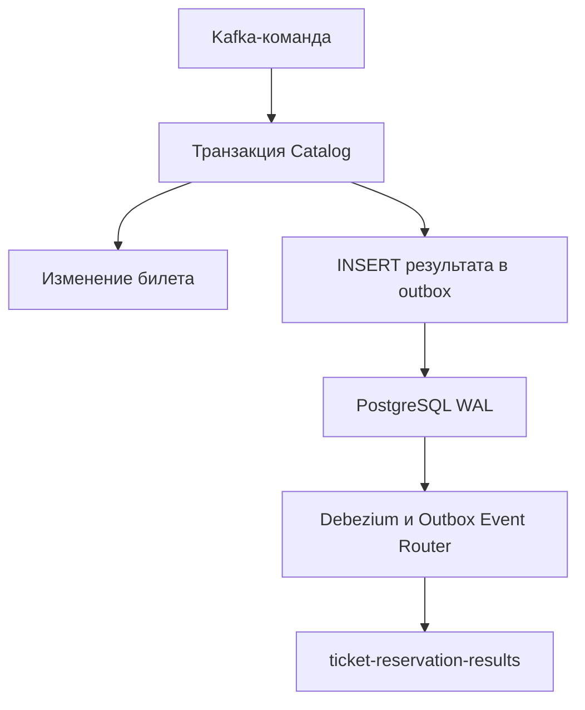

# Catalog Service

Сервис каталога мероприятий и билетов в Ticket Craft. Владеет PostgreSQL-базой `catalog_db` и отвечает за доступность, резервирование, подтверждение продажи и освобождение билетов.

Результаты обработки команд сохраняются через Transactional Outbox. В Kafka их публикует Debezium, работающий в Kafka Connect.

[← Обзор проекта](../README.md)

## Ответственность сервиса

Catalog Service отвечает за:

- получение списка мероприятий и деталей мероприятия;
- хранение билетов и их цен;
- конкурентное резервирование билета;
- проверку принадлежности и срока действия резерва;
- подтверждение продажи;
- освобождение резерва;
- публикацию результатов обработки команд.

Order Service управляет Saga и определяет следующий шаг покупки. Catalog не принимает решение об оплате или возврате денег.

## Технологии

| Компонент | Назначение |
|---|---|
| Java 21, Spring Boot | Реализация приложения |
| Spring MVC | HTTP API |
| Spring Security OAuth2 Resource Server | JWT-аутентификация защищённых запросов |
| Spring Data JPA | Работа с мероприятиями и билетами |
| Spring JDBC | Запись результатов в outbox |
| PostgreSQL 16 | Данные каталога и outbox |
| Flyway | Миграции схемы |
| Redis | Кеширование и ограничение HTTP-запросов |
| Spring Kafka | Получение команд, retry и DLT |
| Kafka Connect, Debezium | CDC-доставка outbox в Kafka |
| Micrometer, Prometheus, OpenTelemetry | Метрики и трассировка |

## HTTP API

Локальный порт — `8081`.

| Метод | Endpoint | Назначение |
|---|---|---|
| `GET` | `/api/v1/catalog/events` | Список мероприятий |
| `GET` | `/api/v1/catalog/events/{eventId}` | Мероприятие и его билеты |

Чтение каталога разрешено без аутентификации.

### Security

Сервис настроен как JWT Resource Server.

В локальном профиле:

- issuer: `http://localhost:9000/realms/ticketcraft`;
- JWK Set:
  `http://localhost:9000/realms/ticketcraft/protocol/openid-connect/certs`;
- audience: `ticketcraft-api`.

Переопределение:

- `JWT_ISSUER_URI`;
- `JWT_JWK_SET_URI`;
- `JWT_AUDIENCE`.

Публичный endpoint не требует токена. Переданный невалидный Bearer-токен может быть отклонён даже при обращении к публичному каталогу.

Health endpoints и `/actuator/info` публичны. Доступ к `/actuator/prometheus` определяется `ticketcraft.security.metrics-public`: при отключённом публичном доступе нужен scope `metrics.read`.

### Диагностический endpoint

`GET /debug/slow` позволяет моделировать задержки и HTTP-статусы для проверки Gateway.

Сейчас endpoint зарегистрирован без ограничения профилем и разрешён без аутентификации.

Маршрут к нему через Gateway включается только в профиле `local`. Это не ограничивает прямой доступ к Catalog.

Ограничение самого endpoint остаётся в backlog.

## Кеширование и rate limiting

Список мероприятий кешируется в Redis.

TTL по умолчанию:

```yaml
catalog:
  cache:
    events-ttl: 5m
```

Детальный ответ мероприятия с билетами не кешируется как долгоживущий снимок доступности.

Сервис также имеет собственное Redis-based ограничение чтения каталога:

```yaml
ticketcraft:
  rate-limit:
    enabled: true
    catalog-read:
      capacity: 120
      refill-tokens: 120
      refill-period: 1m
```

Этот лимит работает отдельно от rate limiting в API Gateway. При обращении через Gateway запрос проходит оба уровня ограничений.

## Kafka-контракт

| Назначение | Топик по умолчанию | Сообщения |
|---|---|---|
| Входящие команды | `ticket-reservation-commands` | `ReserveTicketCommand`, `ConfirmTicketCommand`, `ReleaseTicketCommand` |
| Исходящие результаты | `ticket-reservation-results` | `TicketReservedEvent`, `TicketReservationFailedEvent`, `TicketConfirmedEvent`, `TicketConfirmationFailedEvent`, `TicketReleasedEvent` |
| Ошибки обработки команд | `ticket-reservation-commands.DLT` | Необработанные команды |

Имена топиков задаются через `ticketcraft.kafka.topics`.

Consumer group по умолчанию — `catalog-ticket-reservation`. Переопределение — `CATALOG_KAFKA_GROUP_ID`.

Для сообщений, поступающих из Debezium Order, настроены type mappings:

| Header `__TypeId__` | DTO |
|---|---|
| `ReserveTicket` | `ReserveTicketCommand` |
| `ConfirmTicket` | `ConfirmTicketCommand` |
| `ReleaseTicket` | `ReleaseTicketCommand` |

## Резервирование и продажа

Основной жизненный цикл билета:



### Резервирование

Catalog получает `ReserveTicketCommand`.

Резервирование выполняется атомарным обновлением: билет должен находиться в `AVAILABLE`.

При конкурентных попытках приобрести один билет успешно изменить его состояние сможет только одна операция. Остальные получат результат неуспешного резервирования.

При успехе:
- билет становится `RESERVED`;
- сохраняются `reservationId` и срок действия;
- в outbox записывается `TicketReservedEvent`.

Событие содержит `eventId` и `price`, прочитанные из Catalog. Цена из клиентского HTTP-запроса не используется.

При неуспехе формируется `TicketReservationFailedEvent`.

### Подтверждение

`ConfirmTicketCommand` подтверждает продажу только при выполнении условий:
- билет находится в `RESERVED`;
- `reservationId` совпадает;
- срок резерва ещё не истёк.

При успехе билет становится `SOLD`, создаётся `TicketConfirmedEvent`.

При невозможности подтверждения создаётся `TicketConfirmationFailedEvent` с одной из причин:
- `TICKET_NOT_FOUND`;
- `RESERVATION_EXPIRED`;
- `RESERVATION_MISMATCH`.

Повтор подтверждения уже проданного билета с тем же `reservationId` учитывается реализацией.

### Освобождение

`ReleaseTicketCommand` освобождает билет, зарезервированный указанным `reservationId`.

При успехе:
- статус становится `AVAILABLE`;
- данные резерва очищаются;
- создаётся `TicketReleasedEvent`.

Если билет уже `AVAILABLE`, команда также может завершиться результатом освобождения.

Билет другого резерва не освобождается. Невозможность корректно выполнить команду приводит к ошибке обработки.

### Истечение резерва

По умолчанию:

```yaml
catalog:
  reservation:
    duration: 10m
    expiration-check-interval: 10s
```

Scheduler периодически освобождает просроченные резервы.

Проверка срока также выполняется при подтверждении: физическое освобождение scheduler-ом не обязано произойти точно в момент истечения TTL.

Текущий scheduler изменяет состояние билетов, но не публикует отдельное событие истечения резерва. Он не завершает Saga в Order автоматически.

## Транзакции и дедупликация

Изменение билета и вставка результата в outbox выполняются в одной локальной транзакции PostgreSQL.

Если запись результата завершается ошибкой, изменение билета откатывается.

Для команды формируется идентификатор результата:
```text
result:<command.messageId>
```

Перед повторным выполнением проверяется наличие результата через `existsByMessageId()`.

В таблице outbox действует уникальное ограничение на `message_id`. Вставка использует:
```sql
ON CONFLICT (message_id) DO NOTHING
```

Проверка существования и уникальное ограничение дополняют друг друга. Проверки состояния билета также участвуют в обработке повторов.

Содержимое сообщений с одинаковым `messageId` не сравнивается.

**История outbox участвует в дедупликации команд.**
Её удаление может убрать защиту от повторного выполнения старых команд. Retention требует согласованного решения о сроке дедупликации.

## Transactional Outbox и CDC

CDC — Change Data Capture, захват изменений данных.



После commit Debezium читает изменение из WAL и публикует результат.

### Структура outbox

| Колонка | Назначение |
|---|---|
| `id` | UUID строки outbox |
| `message_id` | Идентификатор результата для дедупликации |
| `aggregate_type` | Тип агрегата — `ORDER` |
| `aggregate_id` | Строковый `orderId`; Kafka key |
| `event_type` | Логический тип результата |
| `topic` | Целевой топик |
| `payload` | JSON результата |
| `created_at` | Время создания |


### Коннектор

Конфигурация:
[catalog-outbox.json](../docker/kafka-connect/catalog-outbox.json).

| Параметр | Значение |
|---|---|
| Имя | `catalog-outbox` |
| Debezium | `3.3.2.Final` |
| Максимальное число tasks | `1` |
| PostgreSQL внутри Docker | `postgres-catalog:5432` |
| База | `catalog_db` |
| Таблица | `public.outbox_events` |
| Plugin | `pgoutput` |
| Slot | `ticketcraft_catalog_outbox` |
| Publication | `ticketcraft_catalog_outbox_publication` |
| Snapshot mode | `no_data` |
| REST API Connect с хоста | `http://localhost:8085` |

Редактирование файла не меняет работающий коннектор: конфигурация применяется через REST API.

### Формат исходящего сообщения

- Топик берётся из `topic`.
- Kafka key берётся из `aggregate_id`.
- Value содержит JSON из `payload`.
- `event_type` передаётся в header `__TypeId__`.
- UUID строки передаётся в header `id`.

Order использует следующие mappings:

| Header `__TypeId__` | DTO |
|---|---|
| `TicketReserved` | `TicketReservedEvent` |
| `TicketReservationFailed` | `TicketReservationFailedEvent` |
| `TicketConfirmed` | `TicketConfirmedEvent` |
| `TicketConfirmationFailed` | `TicketConfirmationFailedEvent` |
| `TicketReleased` | `TicketReleasedEvent` |

UUID строки outbox отличается от `messageId` результата. Бизнес-дедупликация использует `messageId`.

### Восстановление

`snapshot.mode=no_data` не сканирует существующую таблицу для первоначальной публикации её содержимого.

При обычном перезапуске коннектор продолжает чтение с сохранённой позиции при наличии offsets, slot и нужного WAL.

При первом развёртывании slot должен существовать до начала обработки бизнес-команд.

Если offsets или slot потеряны, накопленная таблица outbox не переотправляется автоматически. Требуется отдельная процедура восстановления.

### Сбои и гарантии

Доставка имеет семантику at-least-once. После восстановления возможны повторные сообщения.

| Ситуация | Поведение |
|---|---|
| Транзакция Catalog откатилась | Результат не публикуется |
| Connect остановлен | Результаты сохраняются в БД, доставка задерживается |
| Connect восстановлен | Чтение продолжается с сохранённой позиции при доступном WAL |
| Ошибка преобразования | При `errors.tolerance=none` task завершается ошибкой |
| Потеря offsets или slot | Требуется процедура восстановления |

Replication slot может удерживать WAL при отставании коннектора. Необходимо контролировать потребление диска PostgreSQL.

Ошибки CDC-доставки не направляются автоматически в DLT входящих команд Catalog.

## Retry и DLT входящих команд

Автоматический commit offset отключён. Используется `AckMode.RECORD`.

Для повторяемых ошибок обработки настроены:
- первоначальная попытка;
- 2 повтора;
- задержка между повторами — 1 секунда.

После исчерпания попыток используется `ticket-reservation-commands.DLT`.

Некоторые категории ошибок, включая ошибки десериализации, могут направляться в DLT без повторов согласно классификации error handler.

`ErrorHandlingDeserializer` перехватывает ошибки десериализации. DLT producer поддерживает исходные байты и JSON-объекты.

Используется исходная партиция сообщения, поэтому DLT должен иметь достаточное число партиций.

Попадание команды в DLT не создаёт бизнес-результат автоматически. Соответствующая Saga Order может остаться в ожидании.

Producer для DLT остаётся в Catalog: Debezium заменяет только публикацию бизнес-результатов из outbox.

## Наблюдаемость

Доступны Actuator endpoints `health`, `info`, `prometheus` с учётом правил security.

Собираются HTTP-метрики, доступны метрики rate limiting и трассировка Kafka consumers и DLT producer.

Метрики старого Java outbox publisher больше не формируются.

Статус коннектора:

```powershell
Invoke-RestMethod `
    -Uri "http://localhost:8085/connectors/catalog-outbox/status" |
    ConvertTo-Json -Depth 10
```

`RUNNING` у connector/task не доказывает отсутствие отставания доставки.

Экспорт метрик Connect/Debezium в Prometheus и отдельные CDC-панели пока не настроены.

OTLP endpoint по умолчанию:

```text
http://localhost:4318/v1/traces
```

Trace context автоматически не сохраняется в durable outbox. Непрерывная трасса через CDC сейчас не гарантируется.

## Запуск

Необходимы Java 21, PostgreSQL, Redis, Kafka и Kafka Connect с Debezium.

## Ограничения и backlog

- Ограничить диагностический `/debug/slow`.
- Настроить CDC-метрики, lag, алерты на FAILED task и объём удерживаемого WAL.
- Автоматизировать первый запуск схемы и коннектора до начала обработки команд.
- Описать восстановление при потере offsets, slot или WAL.
- Подготовить контролируемую повторную публикацию истории outbox.
- Определить retention с учётом дедупликации команд.
- Настроить передачу trace context через outbox.
- Подготовить процедуру анализа и повторной обработки DLT.
- Проверить CDC-восстановление и повторы отдельными интеграционными тестами.

`TicketReservedEvent` содержит обязательные для текущего Order поля `eventId` и `price`.
