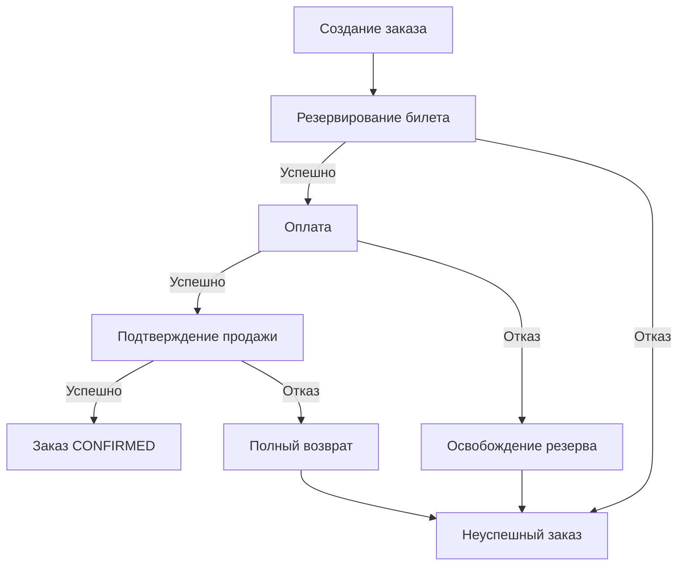

# Спецификация Ticket Craft

## 1. Назначение документа

Документ определяет функциональные и нефункциональные требования к демонстрационной платформе бронирования и покупки билетов Ticket Craft.

Обозначения:

- `FR` — функциональное требование.
- `NFR` — нефункциональное требование.
- `AC` — критерий приёмки.

Указанные числовые ограничения являются текущими настройками, а не подтверждённой производительностью системы.

## 2. Назначение и границы системы

Ticket Craft позволяет пользователю выбрать билет, создать заказ и получить результат покупки.

Процесс включает резервирование билета, оплату и подтверждение продажи. При отказе на отдельных этапах выполняются компенсационные действия.

Проект предназначен для демонстрации распределённого процесса покупки в микросервисной архитектуре.

### Входит в область проекта

- Просмотр мероприятий и билетов.
- Авторизация пользователя через Keycloak.
- Создание и просмотр собственных заказов.
- Резервирование и продажа билета.
- Оплата и полный возврат через платёжного провайдера.
- Асинхронная обработка результатов покупки.
- Имитация уведомления о подтверждённом заказе.
- Запуск демонстрационного окружения через Docker Compose.
- Метрики, логи и трассировка.

### Не входит в область проекта

- Пользовательский веб-интерфейс.
- Административный интерфейс управления каталогом.
- Корзина и покупка нескольких билетов одним заказом.
- Реальные списания денег.
- Частичные возвраты.
- Реальная отправка email, SMS и push.
- Полностью автоматическое восстановление всех зависших процессов.
- Обеспечение production SLA и высокой доступности инфраструктуры.

## 3. Участники и компоненты

### Участники

| Участник | Возможности |
|---|---|
| Посетитель | Просмотр каталога без авторизации |
| Авторизованный пользователь | Создание заказа и просмотр своих заказов |
| Разработчик или проверяющий | Запуск окружения, проверка покупки, просмотр диагностики |
| Платёжный провайдер | Выполнение оплаты и возврата; в демо используется эмулятор |

### Ответственность сервисов

| Компонент | Ответственность |
|---|---|
| API Gateway | Входная точка HTTP API, проверка JWT, маршрутизация и защита от перегрузки |
| Catalog Service | Мероприятия, билеты, резервирование, продажа и освобождение резервов |
| Order Service | Заказы и оркестрация процесса покупки |
| Payment Service | Взаимодействие с платёжным провайдером |
| Notification Service | Обработка подтверждённых заказов и имитация уведомления |

Каждый бизнес-сервис владеет собственной PostgreSQL-базой.
Прямое изменение данных другого сервиса не является способом
межсервисного взаимодействия.

Клиентские обращения выполняются через Gateway.
Процесс покупки между бизнес-сервисами выполняется асинхронно через Kafka.

## 4. Основной сценарий покупки

1. Пользователь просматривает мероприятия и выбирает доступный билет.
2. Получает access token в Keycloak.
3. Создаёт заказ, передавая билет и `Idempotency-Key`.
4. Order Service сохраняет заказ и запускает процесс покупки.
5. Catalog Service резервирует билет.
6. Payment Service выполняет оплату.
7. Catalog Service подтверждает продажу билета.
8. Order Service переводит заказ в `CONFIRMED`.
9. Notification Service обрабатывает информацию о подтверждённом заказе.

Ответ на создание заказа подтверждает создание ресурса,
но не завершение всей покупки. Финальный результат пользователь
получает отдельным запросом заказа.



Схема показывает основные бизнес-ветки.
Компенсации также выполняются асинхронно и могут завершиться ошибкой
или потребовать повторной обработки.

## 5. Функциональные требования

### 5.1. Каталог

#### FR-CATALOG-01. Просмотр мероприятий

Система должна предоставлять список мероприятий без авторизации.

Результат содержит идентификатор, название, описание,
дату проведения и место проведения мероприятия.

#### FR-CATALOG-02. Просмотр мероприятия и билетов

Система должна предоставлять сведения об отдельном мероприятии
и его билетах.

Для билета доступны идентификатор, место, цена и текущее состояние.

Отсутствующее мероприятие не должно возвращаться как существующее.

#### FR-CATALOG-03. Конкурентное резервирование

Система должна согласованно изменять состояние билета
при конкурентных попытках резервирования.

Один билет не может одновременно иметь два действующих резерва
для разных заказов.

#### FR-CATALOG-04. Подтверждение продажи

Подтверждение продажи допускается только при выполнении условий
резервирования и принадлежности резерва соответствующему заказу.

После успешного подтверждения билет получает состояние `SOLD`
и не должен повторно продаваться другому заказу.

#### FR-CATALOG-05. Освобождение резервов

Система должна поддерживать освобождение резерва
при неуспешном процессе покупки и обработку истечения его срока.

Просроченный резерв не должен позволять подтвердить продажу
без выполнения предусмотренных проверок.

#### FR-CATALOG-06. Кеширование

Список мероприятий кешируется в Redis.

Детальная информация о мероприятии и состоянии его билетов
не должна обслуживаться из кеша списка мероприятий.

Изменения списка могут становиться видимыми после истечения TTL.
Кеш не используется как источник истины при резервировании и продаже.

### 5.2. Заказы

#### FR-ORDER-01. Создание заказа

Авторизованный пользователь со scope `orders.write`
может создать заказ на один билет.

Запрос должен содержать:

- Bearer access token.
- Заголовок `Idempotency-Key`.
- Идентификатор билета.

Пользователь определяется по проверенному токену,
а не по произвольно переданному идентификатору в теле запроса.

Первичное успешное создание возвращает `201 Created`
и сведения о созданном заказе.

#### FR-ORDER-02. Идемпотентность создания

Повтор запроса с тем же ключом и теми же значимыми параметрами
не должен создавать дополнительный заказ.

Повторное использование ключа с несовместимыми параметрами
должно отклоняться.

Проверка должна сохранять корректность при конкурентных запросах.

После неопределённого результата HTTP-запроса клиент должен
повторять ту же операцию с прежним `Idempotency-Key`.

#### FR-ORDER-03. Просмотр заказа

Авторизованный пользователь со scope `orders.read`
может получить сведения о собственном заказе.

Данные чужого заказа не должны выдаваться пользователю.

#### FR-ORDER-04. Управление покупкой

Order Service должен хранить состояние процесса покупки
и выбирать следующий шаг на основе результатов предыдущих шагов.

Заказ может получить состояние `CONFIRMED` только после
успешной оплаты и подтверждения продажи билета.

#### FR-ORDER-05. Компенсационные действия

При отказе оплаты процесс должен предусматривать освобождение резерва.

При успешной оплате и последующем отказе подтверждения продажи
процесс должен предусматривать полный возврат оплаты.

Отправка команды компенсации не равнозначна
успешному завершению компенсации.

#### FR-ORDER-06. Повторные и неактуальные результаты

Повторная доставка уже обработанного результата не должна
повторно выполнять соответствующее бизнес-действие.

Результат должен обрабатываться с учётом текущего состояния заказа
и принадлежности операции соответствующему процессу покупки.

### 5.3. Платежи

#### FR-PAYMENT-01. Выполнение оплаты

Payment Service должен получать запрос оплаты асинхронно
и обращаться к платёжному провайдеру по HTTP.

Сервис должен проверять денежные значения перед выполнением операции.

Клиентского REST API для непосредственного выполнения оплаты нет.

#### FR-PAYMENT-02. Защита от повторной оплаты

Повторная обработка одной операции не должна создавать
новую независимую платёжную операцию.

При обращениях к провайдеру должен использоваться
стабильный ключ идемпотентности соответствующей операции.

Защита внешнего списания зависит также от соблюдения
контракта идемпотентности платёжным провайдером.

#### FR-PAYMENT-03. Полный возврат

Система должна поддерживать полный возврат проведённой оплаты
как компенсацию неуспешной покупки.

Повторное выполнение запроса возврата не должно создавать
дополнительный независимый возврат.

Частичный возврат не поддерживается.

#### FR-PAYMENT-04. Неопределённый результат вызова

Таймаут или ошибка HTTP-вызова не должны автоматически
интерпретироваться как доказательство отсутствия списания.

Для предусмотренных категорий ошибок сервис должен запрашивать
результат операции у провайдера.

Фоновая сверка всех неопределённых операций в текущую версию не входит.

#### FR-PAYMENT-05. Демонстрационный провайдер

В стандартном Docker-окружении должен использоваться
платёжный эмулятор, не выполняющий реальные списания.

Он должен позволять пройти хотя бы один полный сценарий покупки
без внешней платёжной системы.

### 5.4. Уведомления

#### FR-NOTIFY-01. Обработка подтверждённого заказа

Notification Service должен получать информацию
о подтверждённых заказах асинхронно.

Обработка уведомления не является условием перехода заказа
в `CONFIRMED`.

#### FR-NOTIFY-02. Имитация отправки

В демонстрационной версии отправка уведомления
имитируется записью в лог.

Факт обработки сообщения учитывается в PostgreSQL
для защиты от повторной обработки.

Запись в лог не является транзакционной относительно БД:
при сбоях повторные строки допустимы.

### 5.5. API Gateway

#### FR-GATEWAY-01. Маршрутизация

Gateway должен предоставлять следующие клиентские операции:

| Метод | Путь | Назначение |
|---|---|---|
| `GET` | `/api/v1/catalog/events` | Список мероприятий |
| `GET` | `/api/v1/catalog/events/{eventId}` | Мероприятие и билеты |
| `POST` | `/api/v1/orders` | Создание заказа |
| `GET` | `/api/v1/orders/{orderId}` | Просмотр заказа |

#### FR-GATEWAY-02. Корреляция запросов

Gateway должен принимать или формировать correlation ID,
передавать его downstream-сервису и возвращать клиенту.

Ответы об ошибках Gateway должны содержать correlation ID.

#### FR-GATEWAY-03. Единый формат ошибок

Ошибки, формируемые Gateway, должны возвращаться
в формате Problem Detail с HTTP-статусом, описанием,
путём исходного запроса и прикладным кодом ошибки.

#### FR-GATEWAY-04. Внутренние fallback-маршруты

Fallback-маршруты должны использоваться для внутренней
обработки ошибок Circuit Breaker.

Прямое клиентское обращение к `/fallback/**`
должно возвращать `404`.

## 6. Нефункциональные требования

### 6.1. Согласованность и доставка

#### NFR-DATA-01. Локальная атомарность

Бизнес-изменения и соответствующие исходящие сообщения
должны сохраняться в одной локальной транзакции PostgreSQL.

Публикация исходящих сообщений выполняется через
Transactional Outbox и CDC.

#### NFR-DATA-02. Допустимость повторной доставки

Обработка сообщений должна учитывать возможность повторной доставки.

Общая гарантия exactly-once между PostgreSQL, Kafka
и внешним платёжным провайдером не заявляется.

#### NFR-DATA-03. Согласованность между сервисами

Изменения между сервисами распространяются асинхронно.

Промежуточные состояния заказа и временное расхождение
представлений разных сервисов допустимы.

Система не использует общую распределённую транзакцию
для всей покупки.

### 6.2. Безопасность

#### NFR-SEC-01. Проверка JWT

Gateway и защищённые бизнес-endpoint должны проверять
подпись JWT, срок действия, issuer и audience.

Защищённые сервисы не должны полагаться исключительно
на факт прохождения запроса через Gateway.

#### NFR-SEC-02. Авторизация

Order Service должен проверять необходимые scopes
и принадлежность заказа пользователю.

Проверка подлинности токена не заменяет бизнес-авторизацию.

#### NFR-SEC-03. Недоверенные proxy-заголовки

При прямом подключении клиента Gateway должен удалять
входящие `Forwarded` и поддерживаемые `X-Forwarded-*`
без применения переданных значений.

Подмена этих заголовков не должна изменять IP-ключ rate limiting.

Размещение за доверенным reverse proxy требует отдельной настройки.

#### NFR-SEC-04. Диагностические endpoint

Liveness/readiness Gateway доступны без авторизации
и не раскрывают детали компонентов.

В базовой конфигурации и профиле `prod`
доступ к `/actuator/prometheus` требует scope `metrics.read`.

В демонстрационных профилях `docker` и `local`
этот endpoint может быть открыт.

### 6.3. Управление нагрузкой

#### NFR-LOAD-01. Ограничение частоты

Gateway должен ограничивать частоту запросов:

| Маршрут | Ключ | Пополнение | Ёмкость |
|---|---|---|---|
| Каталог | IP подключения | 10 токенов/с | 20 |
| Заказы | JWT subject | 5 токенов/с | 10 |

Один запрос расходует один токен.
При исчерпании лимита возвращается `429`.

При недоступности Redis применяется fail-open.
Деградация должна отражаться в логах и метриках.

#### NFR-LOAD-02. Ограничение параллельности

Gateway должен ограничивать число одновременно обрабатываемых
запросов на каждом экземпляре:

- Catalog — 64.
- Order — 32.

При исчерпании лимита запрос отклоняется без ожидания в очереди
с ответом `503` и заголовком `Retry-After`.

Лимит должен освобождаться после завершения, ошибки
или отмены обработки запроса.

#### NFR-LOAD-03. Ограничение тела запроса

Gateway должен проверять фактический размер тела,
включая запросы без `Content-Length`.

Значения по умолчанию:

- Максимальный размер — 64 KB.
- Время чтения тела — 5 с.

Превышение размера возвращает `413`.
Превышение времени чтения возвращает `408`.

#### NFR-LOAD-04. Пул HTTP-соединений

Gateway должен использовать ограниченный пул
соединений к downstream-сервисам.

Значения по умолчанию:

| Параметр | Значение |
|---|---|
| Максимум соединений на downstream-адрес | 64 |
| Ожидание свободного соединения | 500 мс |
| Максимальное время простоя | 30 с |
| Максимальное время жизни | 5 мин |
| Интервал фоновой проверки | 10 с |

Пул не является единственным ограничителем нагрузки.
Количество обрабатываемых запросов дополнительно
ограничивается Bulkhead.

### 6.4. Отказоустойчивость

#### NFR-RES-01. Ограничение ожидания downstream

Gateway должен использовать таймауты и Circuit Breaker,
чтобы ограничивать влияние недоступного или медленного сервиса.

Текущие настройки:

- Установка HTTP-соединения — 2 с.
- HTTP response timeout — 5 с.
- TimeLimiter маршрута — 4 с.

Эти значения относятся к разным этапам обработки
и не складываются в гарантированный общий срок запроса.

#### NFR-RES-02. Повторные попытки и DLT

Временные ошибки обработки сообщений должны допускать
ограниченное число повторных попыток.

После исчерпания попыток проблемное сообщение должно
направляться в Dead Letter Topic для дальнейшего разбора.

Наличие DLT не означает автоматического завершения
соответствующей бизнес-операции.

#### NFR-RES-03. Корректная остановка Gateway

После получения сигнала штатной остановки Gateway
должен предоставить активным запросам возможность завершиться
в пределах настроенного времени.

Таймаут фазы завершения Spring — 30 с.
Период ожидания Docker Compose — 45 с.

Обычные таймауты запросов продолжают действовать во время остановки.

### 6.5. Наблюдаемость

#### NFR-OBS-01. Метрики

Система должна предоставлять метрики приложений
для сбора Prometheus.

Для Gateway доступны метрики HTTP-пула
и деградации rate limiter.

#### NFR-OBS-02. Логи

Логи должны позволять определить этап обработки
и исследовать ошибки покупки.

Для HTTP-запросов используется correlation ID.

#### NFR-OBS-03. Трассировка

Сервисы должны поддерживать экспорт трассировок через OTLP в Jaeger.

Наличие единой непрерывной трассы через весь процесс
PostgreSQL → CDC → Kafka не гарантируется.

#### NFR-OBS-04. Health probes Gateway

Gateway должен предоставлять:

- `/actuator/health/liveness`.
- `/actuator/health/readiness`.

Probes отражают состояние приложения.
Redis и downstream-сервисы не включаются в эти группы.

Readiness является сигналом для инфраструктуры;
сам по себе endpoint не реализует балансировку трафика.

### 6.6. Развёртывание и конфигурация

#### NFR-DEPLOY-01. Запуск с нуля

После клонирования репозитория и подготовки `.env`
всё демонстрационное окружение должно запускаться командой:

```powershell
docker compose up -d --build
```

Локально установленные JDK, Maven и IDE для этого не требуются.

Необходимы Docker, совместимый Docker Compose
и доступ к зависимостям при первой сборке.

#### NFR-DEPLOY-02. Автоматическая подготовка

Полный запуск должен автоматически выполнять:

- Запуск инфраструктуры и приложений.
- Миграции БД.
- Импорт конфигурации Keycloak.
- Подготовку подключений pgAdmin.
- Регистрацию Debezium-коннекторов.
- Загрузку demo-данных.
- Запуск платёжного эмулятора.

Одноразовые контейнеры настройки должны завершаться
с кодом `0` после успешного выполнения.

#### NFR-DEPLOY-03. Внешняя конфигурация

Адреса зависимостей и учётные данные должны задаваться
конфигурацией окружения.

В репозитории должен находиться `.env.example`
с настройками демонстрационного запуска.

#### NFR-DEPLOY-04. Сохранение данных

Обычная остановка и повторный запуск не должны
сбрасывать сохранённые заказы и проданные билеты.

Повторная загрузка demo-данных не должна возвращать
проданные билеты в состояние `AVAILABLE`.

Полный сброс выполняется отдельной командой удаления volumes.

### 6.7. Тестируемость и производительность

#### NFR-TEST-01. Автоматические проверки

Критические сценарии должны проверяться модульными
и интеграционными тестами.

Интеграционные тесты должны использовать управляемые
тестовые зависимости, включая Testcontainers,
без обязательного запуска основного Compose-окружения.

#### NFR-PERF-01. Ограничения производительности

Для текущей версии не установлены подтверждённые целевые
значения throughput, p95/p99 latency и максимального числа пользователей.

Параметры лимитов не являются доказательством
достижения соответствующей производительности.

Числовые цели могут быть установлены после нагрузочного тестирования
с фиксацией ресурсов, профиля нагрузки и состояния зависимостей.

## 7. Критерии приёмки

| ID | Сценарий | Ожидаемый результат |
|---|---|---|
| AC-01 | Чистый запуск Compose | Сервисы работают, одноразовые задачи завершаются успешно |
| AC-02 | Просмотр demo-каталога | Доступно мероприятие и десять билетов на чистом окружении |
| AC-03 | Успешная покупка | Заказ получает `CONFIRMED`, билет — `SOLD` |
| AC-04 | Повтор создания с тем же ключом | Дополнительный заказ не создаётся |
| AC-05 | Повтор ключа с другими параметрами | Запрос отклоняется |
| AC-06 | Конкурентная покупка одного билета | Нет двух успешных продаж одного билета |
| AC-07 | Запрос чужого заказа | Данные заказа не выдаются |
| AC-08 | Недействительный токен | Защищённый запрос отклоняется |
| AC-09 | Недостаточный scope | Операция запрещена |
| AC-10 | Отказ оплаты | Выполняется ветка освобождения резерва |
| AC-11 | Отказ продажи после оплаты | Выполняется ветка полного возврата |
| AC-12 | Повторная доставка сообщения | Нет повторного соответствующего бизнес-эффекта |
| AC-13 | Исчерпание rate limit | Возвращается `429` |
| AC-14 | Исчерпание лимита параллельности | Возвращается `503`, последующие запросы проходят после освобождения лимита |
| AC-15 | Слишком большое тело | Возвращается `413` |
| AC-16 | Слишком медленная отправка тела | Возвращается `408` |
| AC-17 | Исчерпание HTTP-пула | Ожидание ограничено; после освобождения соединения запросы снова проходят |
| AC-18 | Поддельные forwarded-заголовки | IP-ключ не меняется, поддельные значения удаляются |
| AC-19 | Прямой запрос fallback | Возвращается `404` |
| AC-20 | Штатная остановка с активным запросом | Запрос успевает завершиться в пределах таймаута |
| AC-21 | Недоступность Redis rate limiter | Запрос допускается, деградация регистрируется |
| AC-22 | Повторный запуск без удаления volumes | Состояние заказов и билетов сохраняется |

Критерии отказов и компенсаций проверяются
при контролируемом воспроизведении соответствующей ошибки.

Перечень критериев не означает, что каждый из них
уже покрыт отдельным сквозным автоматическим тестом.

## 8. Известные ограничения

- Нет общего дедлайна Saga и автоматического восстановления
  всех зависших покупок.
- Заказ может оставаться в промежуточном состоянии,
  если ожидаемый результат потерян для процесса или попал в DLT.
- Нет автоматической фоновой сверки всех неопределённых платежей.
- Повторная обработка DLT требует отдельной процедуры.
- Потеря CDC offsets или replication slot требует
  контролируемого восстановления.
- Уведомления ограничены записью в лог.
- Redis rate limiter работает в fail-open.
- IP-лимит относится к адресу подключения:
  за NAT или reverse proxy несколько клиентов могут разделять один лимит.
- Инфраструктура демо не обеспечивает высокую доступность.
- Keycloak запускается в development-режиме.
- Нагрузочные характеристики и production SLA не подтверждены.

## 9. Направления развития

Следующие возможности являются целями развития,
а не гарантиями текущей версии:

- Общий дедлайн и восстановление зависших Saga.
- Фоновая сверка состояния платежей.
- Контролируемая повторная обработка DLT.
- Реальный провайдер уведомлений с надёжной доставкой.
- Нагрузочные испытания и измеримые SLO.
- Настройка TLS и доверенного reverse proxy.
- Production-конфигурация Keycloak и управления секретами.
- Резервное копирование и проверяемое восстановление данных.
- Высокая доступность инфраструктуры и отказные испытания.