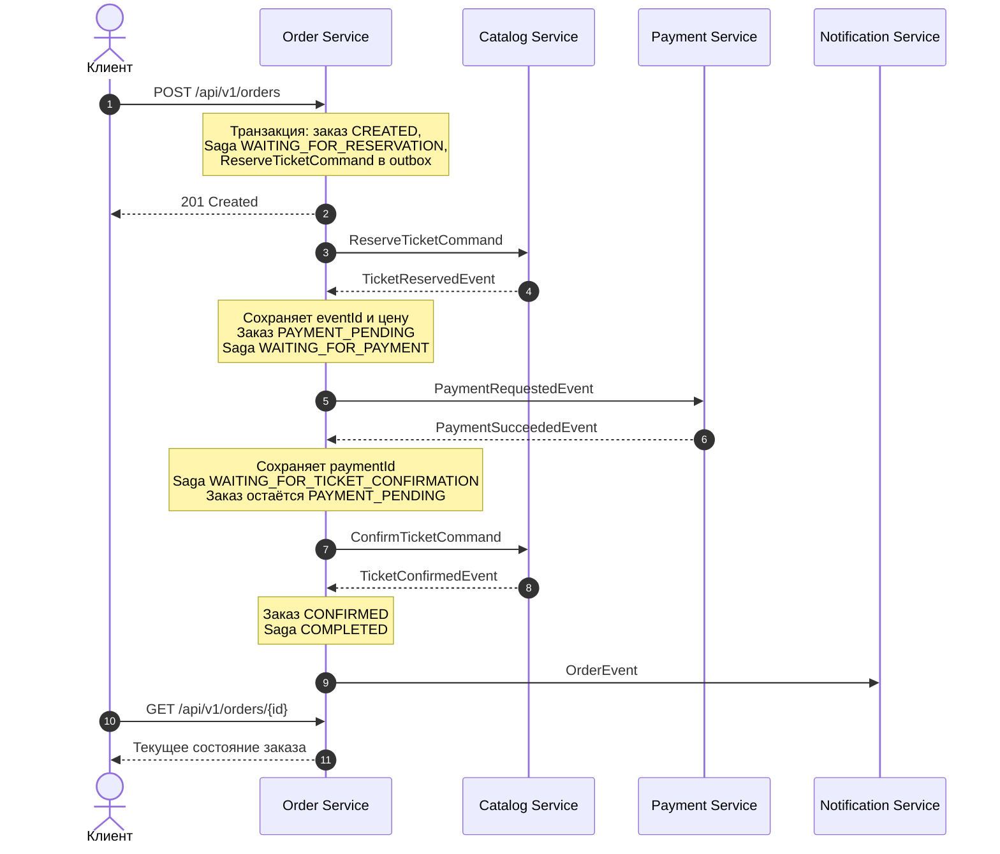
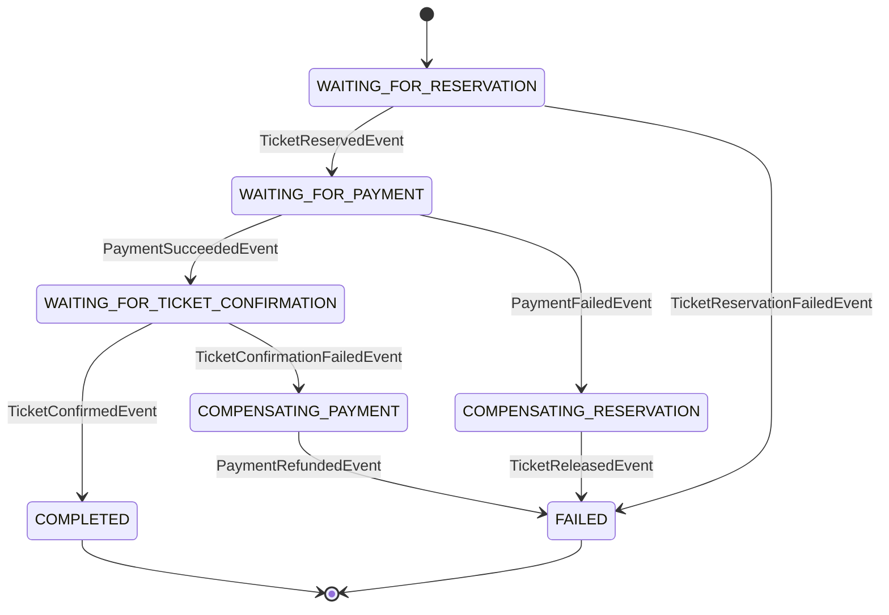

# Order Service

Сервис создания заказов и оркестратор асинхронной Saga покупки билетов в Ticket Craft.

Order Service хранит заказы, управляет последовательностью резервирования, оплаты и подтверждения билета, инициирует компенсации при бизнес-ошибках.

[← Обзор проекта](../README.md)

Учебный MVP для изучения микросервисной архитектуры.

Реализованы:

- создание и получение заказов;
- JWT-аутентификация, проверка scopes и владельца заказа;
- идемпотентное создание заказа;
- оркестрация Saga через Kafka;
- компенсации резервирования и оплаты;
- Transactional Outbox;
- дедупликация входящих событий;
- повторная обработка сообщений и DLT;
- метрики и распределённая трассировка.

## Технологии

| Компонент | Назначение |
|---|---|
| Java 21 | Язык и среда выполнения |
| Spring Boot | Конфигурация и запуск приложения |
| Spring MVC | HTTP API |
| Spring Security OAuth2 Resource Server | Проверка JWT и ограничение доступа |
| Spring Data JDBC, JdbcTemplate | Работа с PostgreSQL |
| PostgreSQL | Заказы, Saga, идемпотентность и outbox |
| Flyway | Версионирование схемы БД |
| Spring Kafka | Обмен командами и событиями |
| Jackson | Сериализация сообщений |
| Micrometer, Prometheus | Метрики |
| OpenTelemetry | Распределённая трассировка |
| JUnit, Mockito, Testcontainers | Автоматические тесты |

## HTTP API

По умолчанию сервис слушает порт `8082`.

### Создание заказа

```http
POST /api/v1/orders
Authorization: Bearer <access_token>
Idempotency-Key: <unique_key>
Content-Type: application/json
```

```json
{
  "ticketId": "22222222-2222-2222-2222-222222222222"
}
```

Требования:

- JWT должен пройти проверку;
- необходим scope `orders.write`;
- JWT должен содержать корректный `user_id`;
- заголовок `Idempotency-Key` обязателен;
- `ticketId` обязателен и должен быть UUID.

Пользователь определяется по JWT. Клиент не передаёт владельца заказа в теле запроса.

При успешном создании возвращается:

```http
HTTP/1.1 201 Created
Location: /api/v1/orders/12174
```

Пример начального состояния:

```json
{
  "id": 12174,
  "userId": 1001,
  "eventId": null,
  "ticketId": "22222222-2222-2222-2222-222222222222",
  "totalPrice": null,
  "status": "CREATED",
  "createdAt": "2026-10-23T10:05:58.083910Z"
}
```

`201 Created` означает, что заказ создан и начат асинхронный процесс покупки. Это не подтверждение оплаты или продажи билета.

`eventId` и `totalPrice` заполняются после получения результата резервирования от Catalog Service. Цена берётся из результата Catalog, а не из HTTP-запроса клиента.

### Получение заказа

```http
GET /api/v1/orders/{orderId}
Authorization: Bearer <access_token>
```

Требуется scope `orders.read`.

Пользователь может получить только собственный заказ. Несуществующий заказ и заказ другого пользователя возвращают одинаковый статус `404`.

Пример завершённой покупки:

```json
{
  "id": 12174,
  "userId": 1001,
  "eventId": "11111111-1111-1111-1111-111111111111",
  "ticketId": "22222222-2222-2222-2222-222222222222",
  "totalPrice": 1500.00,
  "status": "CONFIRMED",
  "createdAt": "2026-10-23T10:05:58.083910Z"
}
```

### HTTP-ошибки

Ошибки API представлены в формате Problem Details.

| Статус | Ситуация |
|---|---|
| `400 Bad Request` | Отсутствует обязательный заголовок, некорректны JSON, UUID или параметр пути |
| `401 Unauthorized` | JWT отсутствует или не проходит проверку |
| `403 Forbidden` | Недостаточно scope либо невозможно определить корректный `user_id` |
| `404 Not Found` | Заказ не найден или принадлежит другому пользователю |
| `409 Conflict` | Конфликт идемпотентности или недопустимый переход состояния |

Пустой или превышающий 128 символов `Idempotency-Key` обрабатывается как конфликт и возвращает `409`. Полностью отсутствующий заголовок возвращает `400`.

## Security

Сервис работает как самостоятельный OAuth2 Resource Server.

Даже если запрос проходит через API Gateway, Order Service самостоятельно проверяет JWT:

- подпись;
- срок действия;
- issuer;
- audience.

Это сохраняет проверку аутентификации при прямом обращении к сервису.

### Правила доступа

| Запрос | Требование |
|---|---|
| `POST /api/v1/orders` | `SCOPE_orders.write` |
| `GET /api/v1/orders/{orderId}` | `SCOPE_orders.read` и владение заказом |
| `/actuator/health`, вложенные health endpoints | Публичный доступ |
| `/actuator/info` | Публичный доступ |
| `/actuator/prometheus` | Публичный доступ при `metrics-public=true`, иначе `SCOPE_metrics.read` |
| Остальные запросы | Доступ запрещён |

Сессии не используются. CSRF отключён для API с Bearer-аутентификацией.

### Настройки JWT

Для профиля `local` значения по умолчанию:

| Настройка | Значение |
|---|---|
| Issuer | `http://localhost:9000/realms/ticketcraft` |
| JWK Set | `http://localhost:9000/realms/ticketcraft/protocol/openid-connect/certs` |
| Audience | `ticketcraft-api` |

Переменные окружения:

- `JWT_ISSUER_URI`;
- `JWT_JWK_SET_URI`;
- `JWT_AUDIENCE`;
- `METRICS_PUBLIC`.

В профиле `local` метрики по умолчанию публичны, в `prod` — требуют scope.

## Идемпотентность создания заказа

Ключ `Idempotency-Key` хранится в PostgreSQL вместе с владельцем, хешем запроса и идентификатором заказа.

Хеш учитывает `userId` и `ticketId`.

| Ситуация | Поведение |
|---|---|
| Новый ключ | Создаётся заказ и запускается Saga |
| Тот же ключ, пользователь и запрос | Возвращается существующий заказ |
| Тот же ключ, другой пользователь | `409 Conflict` |
| Тот же ключ, другой билет | `409 Conflict` |
| Ключ находится в состоянии обработки | `409 Conflict` |
| Другой ключ с тем же билетом | Может быть создан отдельный заказ; доступность проверяет Catalog |

Ключи имеют общее пространство имён в таблице: один ключ нельзя независимо использовать для разных пользователей.

При повторном успешном POST возвращается `201` и **текущее состояние существующего заказа**, а не сохранённая копия первого HTTP-ответа. Поэтому повторный POST может вернуть заказ со статусом `CONFIRMED` или `CANCELED`.

Завершение обработки ключа означает завершение транзакции создания заказа. Оно не означает завершение Saga.

## Saga покупки билета

Используется оркестрация: Order Service хранит состояние процесса и решает, какую команду отправить следующей.

Общей транзакции между Order, Catalog, Payment и Kafka нет. Каждый сервис выполняет собственные локальные транзакции.

### Успешный сценарий

На схеме межсервисные команды и события передаются через Kafka. Исходящие сообщения Order сначала сохраняются в outbox.



Диаграмма показывает бизнес-порядок шагов. Ответ POST и фактическая отправка первого сообщения выполняются независимо после фиксации транзакции.

### Шаг 1. Создание заказа

В одной транзакции:

1. Регистрируется ключ идемпотентности.
2. Создаётся заказ со статусом `CREATED`.
3. Создаётся Saga со статусом `WAITING_FOR_RESERVATION`.
4. В outbox сохраняется `ReserveTicketCommand`.
5. Ключ идемпотентности связывается с созданным заказом.

Идентификатор Saga используется как `reservationId`.

На этом этапе цена и идентификатор мероприятия ещё неизвестны.

### Шаг 2. Резервирование билета

Catalog Service обрабатывает `ReserveTicketCommand` и возвращает результат.

При `TicketReservedEvent` Order Service:

1. Валидирует событие.
2. Проверяет дедупликацию по `messageId`.
3. Проверяет соответствие заказа, билета и резерва.
4. Сохраняет `eventId` и цену из Catalog.
5. Переводит Saga в `WAITING_FOR_PAYMENT`.
6. Переводит заказ через `TICKETS_RESERVED` в `PAYMENT_PENDING`.
7. Сохраняет `PaymentRequestedEvent` в outbox.

Переходы `TICKETS_RESERVED` и `PAYMENT_PENDING` выполняются в одной транзакции. `TICKETS_RESERVED` не является отдельным длительным этапом ожидания.

### Шаг 3. Оплата

Payment Service выполняет оплату и публикует результат.

При `PaymentSucceededEvent` Order Service:

1. Валидирует событие и проверяет дедупликацию.
2. Сравнивает сумму оплаты с суммой заказа.
3. Сохраняет `paymentId` в Saga.
4. Переводит Saga в `WAITING_FOR_TICKET_CONFIRMATION`.
5. Сохраняет `ConfirmTicketCommand` в outbox.

Заказ пока остаётся в `PAYMENT_PENDING`.

Успешная оплата ещё не означает успешную покупку: Catalog должен подтвердить билет.

### Шаг 4. Подтверждение билета

При `TicketConfirmedEvent`:

1. Проверяются событие, резерв и билет.
2. Saga переходит в `COMPLETED`.
3. Заказ переходит в `CONFIRMED`.
4. В outbox сохраняется `OrderEvent`.

Notification Service получает событие из `order-events`.

Ошибка обработки уведомления не отменяет подтверждённый заказ.

## Состояния Saga



| Состояние Saga | Значение |
|---|---|
| `WAITING_FOR_RESERVATION` | Ожидается результат резервирования |
| `WAITING_FOR_PAYMENT` | Билет зарезервирован, ожидается результат оплаты |
| `WAITING_FOR_TICKET_CONFIRMATION` | Оплата успешна, ожидается подтверждение билета |
| `COMPENSATING_RESERVATION` | Оплата отклонена, ожидается освобождение резерва |
| `COMPENSATING_PAYMENT` | Билет не подтверждён после оплаты, ожидается возврат денег |
| `COMPLETED` | Покупка успешно завершена |
| `FAILED` | Покупка не состоялась; при необходимости получен результат компенсации |

## Компенсации

Компенсация — отдельная бизнес-операция, а не откат общей транзакции.

### Билет не удалось зарезервировать

Получено `TicketReservationFailedEvent`.

- Saga: `WAITING_FOR_RESERVATION → FAILED`.
- Заказ: `CREATED → CANCELED`.
- Запрос на оплату не создаётся.
- Возврат денег не требуется.

### Оплата отклонена

Получено `PaymentFailedEvent`.

1. Saga переходит в `COMPENSATING_RESERVATION`.
2. Заказ переходит из `PAYMENT_PENDING` в `PAYMENT_FAILED`.
3. Создаётся `ReleaseTicketCommand`.
4. После `TicketReleasedEvent` Saga переходит в `FAILED`.
5. Заказ переходит из `PAYMENT_FAILED` в `CANCELED`.

Пока освобождение резерва не подтверждено, компенсация не считается завершённой.

Возврат денег в этой ветке не создаётся: получен результат неуспешной оплаты.

### Оплата успешна, но билет не подтверждён

Получено `TicketConfirmationFailedEvent`.

Причины включают:

- `TICKET_NOT_FOUND`;
- `RESERVATION_EXPIRED`;
- `RESERVATION_MISMATCH`.

Порядок обработки:

1. Saga переходит в `COMPENSATING_PAYMENT`.
2. Заказ остаётся в `PAYMENT_PENDING`.
3. Создаётся `RefundPaymentCommand` с сохранённым `paymentId` и суммой заказа.
4. Payment Service выполняет возврат.
5. При `PaymentRefundedEvent` проверяются `paymentId` и сумма.
6. Заказ переходит в `CANCELED`, Saga — в `FAILED`.

До получения результата возврата заказ не переводится в `CANCELED`.

В этой ветке Order Service не создаёт дополнительный `ReleaseTicketCommand`. Нельзя считать получение `PaymentRefundedEvent` подтверждением освобождения резерва в Catalog.

### Сводная таблица переходов

Все переходы предполагают корректное событие, соответствие заказа и успешные проверки текущего состояния.

| Входящее событие | Новое состояние Saga | Состояние заказа после обработки | Исходящее сообщение |
|---|---|---|---|
| `TicketReservedEvent` | `WAITING_FOR_PAYMENT` | `PAYMENT_PENDING` | `PaymentRequestedEvent` |
| `TicketReservationFailedEvent` | `FAILED` | `CANCELED` | — |
| `PaymentSucceededEvent` | `WAITING_FOR_TICKET_CONFIRMATION` | `PAYMENT_PENDING` | `ConfirmTicketCommand` |
| `PaymentFailedEvent` | `COMPENSATING_RESERVATION` | `PAYMENT_FAILED` | `ReleaseTicketCommand` |
| `TicketConfirmedEvent` | `COMPLETED` | `CONFIRMED` | `OrderEvent` |
| `TicketConfirmationFailedEvent` | `COMPENSATING_PAYMENT` | `PAYMENT_PENDING` | `RefundPaymentCommand` |
| `TicketReleasedEvent` | `FAILED` | `CANCELED` | — |
| `PaymentRefundedEvent` | `FAILED` | `CANCELED` | — |

## Транзакционные границы

При обработке результата в одной транзакции PostgreSQL выполняются:

1. Регистрация `messageId` в `processed_events`.
2. Проверки бизнес-состояния.
3. Изменение заказа и Saga.
4. Сохранение следующей команды или события в outbox.

Если обработка завершается исключением, эти изменения откатываются вместе. Таким образом, не возникает успешно зафиксированного перехода состояния без сохранённого исходящего сообщения.

Публикация outbox в Kafka выполняется отдельно от бизнес-транзакции.

## Защита от повторов и конкуренции

### Дедупликация входящих событий

`processed_events` хранит обработанные `messageId`.

Повтор события с уже обработанным идентификатором не применяет бизнес-изменения повторно.

Ограничения:

- дедупликация основана на `messageId`;
- содержимое повторного события не сравнивается с исходным;
- новый `messageId` не считается дубликатом автоматически;
- повтор того же бизнес-результата с новым идентификатором может быть отклонён проверкой состояния.

### Проверки переходов

Обновления выполняются с проверкой ожидаемого состояния.

Например, результат оплаты применяется при ожидании оплаты. Неожиданное состояние не перезаписывается безусловно.

Также проверяются:

- соответствие `reservationId` идентификатору Saga;
- соответствие `ticketId` заказу;
- сумма оплаты или возврата;
- соответствие `paymentId` при возврате.

Это защищает от применения результата к неподходящему заказу или этапу Saga.

### Гарантии доставки

Используется модель **at-least-once**: повторная доставка сообщений возможна.

В частности:

- Kafka может повторно доставить результат после фиксации бизнес-транзакции, если offset не был сохранён;
- outbox может повторно отправить сообщение, если Kafka приняла его, но отметка публикации в PostgreSQL не сохранилась.

## Валидация входящих результатов

Валидация выполняется до регистрации сообщения в `processed_events`.

Общие требования:

- `messageId` не пустой и не длиннее 255 символов;
- `orderId` положительный;
- обязательные идентификаторы и timestamps присутствуют.

Для результатов резервирования проверяются `reservationId`, `ticketId` и `occurredAt`.

Для успешного резервирования дополнительно проверяются `eventId` и цена.

Для результатов оплаты проверяются `paymentId`, `createdAt` и сумма.

Для ошибки подтверждения билета обязательна причина.

Денежные значения должны быть положительными и точно представимыми в `NUMERIC(19,2)`. Значения с ненулевой дробной частью после второго знака отклоняются; округление не выполняется.

## Kafka

### Топики

| Топик по умолчанию | Направление относительно Order | Сообщения |
|---|---|---|
| `ticket-reservation-commands` | Исходящий | `ReserveTicketCommand`, `ConfirmTicketCommand`, `ReleaseTicketCommand` |
| `ticket-reservation-results` | Входящий | Результаты резервирования, подтверждения и освобождения |
| `payment-requests` | Исходящий | `PaymentRequestedEvent` |
| `payment-commands` | Исходящий | `RefundPaymentCommand` |
| `payment-results` | Входящий | `PaymentSucceededEvent`, `PaymentFailedEvent`, `PaymentRefundedEvent` |
| `order-events` | Исходящий | `OrderEvent` после подтверждения заказа |
| `ticket-reservation-results.DLT` | DLT | Необработанные результаты Catalog |
| `payment-results.DLT` | DLT | Необработанные результаты Payment |

Названия настраиваются через `ticketcraft.kafka.topics`.

Для исходящих сообщений используется строковое представление `orderId` как Kafka key.

Одинаковый key направляет сообщения в одну партицию внутри конкретного топика. Это не создаёт общего порядка между разными топиками и не гарантирует порядок публикации outbox несколькими экземплярами приложения.

### Consumer groups

| Поток | Группа по умолчанию |
|---|---|
| Результаты Catalog | `order-ticket-reservation-results` |
| Результаты Payment | `order-payment-results` |

Параметры переопределяются через:

- `ORDER_RESERVATION_RESULTS_GROUP_ID`;
- `ORDER_PAYMENT_RESULTS_GROUP_ID`.

### Подтверждение обработки

Автоматический commit offset отключён. Используется `AckMode.RECORD`.

Бизнес-транзакция завершается до успешного возврата из обработки сообщения. После этого контейнер подтверждает обработанную запись.

### Retry и DLT

Для повторяемой ошибки обработки:

- первоначальная попытка;
- ещё 2 повторные попытки;
- интервал между повторными попытками — 1 секунда;
- после исчерпания попыток — публикация в соответствующий DLT.

Всего — 3 попытки обработки.

`IllegalArgumentException` исключён из повторных попыток: исправить некорректный контракт сообщения простым повтором невозможно.

Ошибки десериализации перехватываются через `ErrorHandlingDeserializer`. DLT-публикация поддерживает как объекты, так и исходные `byte[]`.

DLT использует ту же партицию, что исходное сообщение. Число партиций DLT должно позволять такую публикацию.

Попадание результата в DLT само по себе не завершает Saga и не запускает компенсацию. Saga может остаться в состоянии ожидания.

## Transactional Outbox

Исходящие сообщения хранятся в `outbox_events`.

Publisher периодически выбирает готовые записи, отправляет их в Kafka и отмечает публикацию в PostgreSQL.

### Алгоритм

1. Publisher захватывает одну запись перед её отправкой.
2. Для захвата создаётся отдельный `claimId`.
3. Запись отправляется в Kafka.
4. Publisher ожидает подтверждение отправки.
5. После подтверждения запись отмечается как опубликованная.
6. За один запуск обрабатывается не более `batch-size` записей.

Для конкурентного выбора используется `FOR UPDATE SKIP LOCKED`.

Изменение результата публикации выполняется с проверкой `claimId`: устаревший владелец не должен изменять запись после смены владельца.

### Настройки по умолчанию

Префикс: `ticketcraft.outbox.publisher`.

| Параметр | Значение | Назначение |
|---|---|---|
| `enabled` | `true` | Включение publisher |
| `batch-size` | `100` | Максимальное количество записей за запуск |
| `fixed-delay` | `1s` | Пауза после завершения предыдущего запуска |
| `lock-duration` | `30s` | Срок действия захвата |
| `retry-delay` | `5s` | Задержка повторной попытки после ошибки |
| `send-timeout` | `10s` | Ожидание Kafka acknowledgment |

Это не обещание обработки 100 сообщений в секунду: длительность запуска зависит от Kafka и PostgreSQL.

Параметры проверяются при создании конфигурации:

- `batch-size` должен быть положительным;
- durations должны быть положительными и не меньше 1 миллисекунды;
- `lock-duration` должен превышать `send-timeout`.

Последняя проверка не гарантирует, что любое выполнение уложится в lease: дополнительные задержки возможны при обращении к БД, остановках JVM и работе Kafka client.

### Поведение при сбоях

| Ситуация | Поведение |
|---|---|
| Kafka подтвердила отправку | Publisher пытается отметить запись опубликованной |
| Отправка завершилась исключением | Захват освобождается, следующая попытка назначается через `retry-delay` |
| Истёк `send-timeout` | Результат доставки считается неизвестным; захват остаётся до истечения lease |
| Поток прерван | Флаг прерывания восстанавливается, цикл останавливается, захват истечёт |
| Kafka приняла сообщение, но обновление БД не удалось | Возможна повторная публикация после истечения захвата |
| Освободить захват не удалось | Запись станет доступной после истечения lease |
| Процесс завершился после захвата | Другой запуск сможет подобрать запись после истечения lease |

Истечение ожидания не отменяет уже начатую отправку Kafka. Сообщение может быть доставлено позже, поэтому потребители должны поддерживать идемпотентность.

## Хранение данных

Order Service владеет собственной PostgreSQL-базой `order_db`.

| Таблица | Назначение |
|---|---|
| `orders` | Заказы и их текущие состояния |
| `order_sagas` | Состояния Saga и сохранённый `paymentId` |
| `idempotency_keys` | Ключи идемпотентности HTTP-запросов |
| `outbox_events` | Исходящие сообщения и состояние публикации |
| `processed_events` | Дедупликация входящих событий |

На один заказ приходится одна Saga.

## Наблюдаемость

Доступны:

- `/actuator/health`;
- `/actuator/health/liveness`;
- `/actuator/health/readiness`;
- `/actuator/info`;
- `/actuator/prometheus`.

Собираются:

- HTTP-метрики;
- результаты и длительность публикации outbox;
- дубликаты входящих результатов;
- завершения, ошибки и компенсации Saga.

Счётчик успешной публикации outbox увеличивается после успешного сохранения отметки публикации в БД.

Метрики завершения Saga регистрируются после commit бизнес-транзакции.

Kafka listener и template поддерживают observation. Логи содержат `traceId` и `spanId`, если имеется активный контекст трассировки.

OTLP endpoint по умолчанию:

```text
http://localhost:4318/v1/traces
```

Доля трассировки:

- `local`: `1.0`;
- `prod`: `0.1`.

Переопределение: `TRACING_SAMPLING_PROBABILITY`.

Границы histogram для HTTP-запросов используются для наблюдения.

## Конфигурация

Профиль по умолчанию — `local`.

### Локальные значения

| Компонент | Значение |
|---|---|
| HTTP | `localhost:8082` |
| PostgreSQL | `localhost:5433/order_db` |
| Kafka | `localhost:9092` |
| Количество партиций создаваемых топиков | `1` |
| Replication factor | `1` |
| Consumer concurrency | `1` |

### Основные переменные окружения

| Переменная | Назначение |
|---|---|
| `SERVER_PORT` | HTTP-порт |
| `ORDER_DB_URL` | JDBC URL в профиле `prod` |
| `ORDER_DB_USERNAME` | Пользователь PostgreSQL |
| `ORDER_DB_PASSWORD` | Пароль PostgreSQL |
| `KAFKA_BOOTSTRAP_SERVERS` | Адреса Kafka brokers |
| `JWT_ISSUER_URI` | Ожидаемый issuer |
| `JWT_JWK_SET_URI` | Адрес JWK Set |
| `JWT_AUDIENCE` | Ожидаемая audience |
| `METRICS_PUBLIC` | Публичность Prometheus endpoint |
| `ORDER_KAFKA_CONCURRENCY` | Consumer concurrency в `prod` |
| `KAFKA_TOPIC_PARTITIONS` | Количество партиций создаваемых топиков в `prod` |
| `KAFKA_TOPIC_REPLICAS` | Replication factor в `prod` |
| `OTEL_EXPORTER_OTLP_TRACES_ENDPOINT` | Endpoint экспорта traces |
| `TRACING_SAMPLING_PROBABILITY` | Доля трассируемых запросов |

В профиле `prod` concurrency, partitions и replicas по умолчанию равны `3`.

## Запуск

Необходимы:

- JDK 21;
- PostgreSQL;
- Kafka;
- Identity Provider для аутентифицированных HTTP-запросов.

Для полного сценария покупки также нужны Catalog Service, Payment Service и его платёжный провайдер.

Notification Service нужен для обработки итогового события, но его недоступность не блокирует завершение покупки.

Из корня репозитория:

```powershell
.\mvnw.cmd -pl order-service -am install -DskipTests
.\mvnw.cmd -pl order-service spring-boot:run
```
## Ограничения MVP

- POST создаёт заказ асинхронно; результат покупки нужно получать отдельным GET.
- Нет общего дедлайна Saga и автоматического завершения по таймауту.
- Если ожидаемое событие не пришло или попало в DLT, Saga может остаться в ожидании.
- Не реализована автоматическая сверка состояния с Catalog и Payment.
- Доставка сообщений допускает повторы.
- Дедупликация не сравнивает payload сообщений с одинаковым `messageId`.
- Нет автоматического согласования произвольных событий, пришедших вне ожидаемого порядка.
- Возврат денег после ошибки подтверждения не сопровождается отдельной командой освобождения резерва из Order.
- Нет автоматической очистки истории outbox, обработанных событий и ключей идемпотентности.
- Нет гарантированного времени завершения покупки.

## Backlog

### Восстановление Saga

- Дедлайны этапов и обнаружение зависших Saga.
- Сверка состояний заказа, резерва и оплаты между сервисами.
- Правила восстановления после потери или длительной задержки результата.
- Уточнение завершения резервирования в ветке возврата после ошибки подтверждения.

### Эксплуатация

- Процедура анализа и безопасного повторного запуска сообщений из DLT.
- Инструменты ручного восстановления Saga с аудитом действий.
- Retention и очистка `outbox_events`, `processed_events`, `idempotency_keys`.
- Мониторинг возраста неопубликованных сообщений и длительности ожидания Saga.
- Обработка постоянно неотправляемых outbox-записей.
