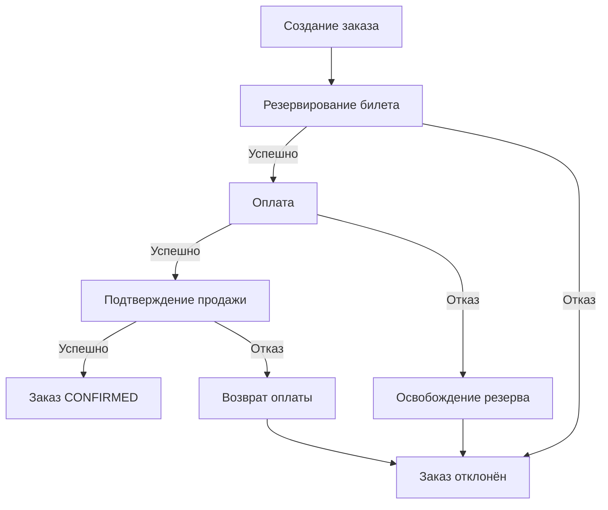

# Order Service

Сервис заказов Ticket Craft. Принимает запрос на покупку билета
и управляет распределённым процессом резервирования,
оплаты и подтверждения продажи.

[← Обзор проекта и быстрый старт](../README.md)

## Роль в архитектуре

Клиент создаёт и просматривает заказы через API Gateway.
Order Service проверяет права пользователя и принадлежность заказа.

Сервис выступает оркестратором Saga:
отправляет команды через Kafka, обрабатывает результаты
Catalog Service и Payment Service и выбирает следующий шаг покупки.

Заказы и состояние процесса сохраняются в собственной PostgreSQL-базе.
Исходящие сообщения публикуются через Transactional Outbox и Debezium.



Схема показывает основные бизнес-ветки.
Шаги выполняются асинхронно и могут потребовать повторной обработки.

## Технологии

Java 21, Spring Boot, Spring MVC, Spring Security,
Spring Data JDBC, PostgreSQL, Flyway, Spring Kafka,
Actuator, Micrometer и OpenTelemetry.

## Основные возможности

- Создание и просмотр заказов.
- Оркестрация Saga покупки.
- Компенсационные действия при неуспешных шагах.
- Идемпотентность создания заказа.
- Проверка scopes и принадлежности заказа пользователю.
- Дедупликация входящих результатов.
- Transactional Outbox, retry и Dead Letter Queue.
- Метрики процесса покупки и распределённая трассировка.

## API и проверка

HTTP-порт — `8082`.
Клиентские запросы отправляются через Gateway на порту `8080`.

| Метод | Путь через Gateway | Назначение | Scope |
|---|---|---|---|
| `POST` | `/api/v1/orders` | Создание заказа | `orders.write` |
| `GET` | `/api/v1/orders/{orderId}` | Просмотр своего заказа | `orders.read` |

Оба запроса требуют Bearer JWT.
Для создания заказа также нужен заголовок `Idempotency-Key`.

Пример создания:

```http
POST http://localhost:8080/api/v1/orders
Authorization: Bearer <access_token>
Content-Type: application/json
Idempotency-Key: demo-order-001
```

```json
{
  "ticketId": "22222222-2222-2222-2222-222222222222"
}
```

Ожидаемый ответ — `201 Created`.
Создание заказа запускает асинхронную покупку:
финальный результат нужно проверить отдельным запросом.

```http
GET http://localhost:8080/api/v1/orders/<id>
Authorization: Bearer <access_token>
```

При успешной покупке заказ переходит в `CONFIRMED`.

Проверка готовности сервиса:

```powershell
curl.exe -i http://localhost:8082/actuator/health
```

Получение токена и полный сценарий покупки описаны
в [корневом README](../README.md#проверка-работоспособности).

## Запуск

Запуск всего проекта:

```powershell
docker compose up -d --build
```

Перед первым запуском подготовьте `.env` по
[инструкции](../README.md#быстрый-старт).

Миграции и регистрация Debezium-коннектора выполняются автоматически.

Просмотр состояния и логов:

```powershell
docker compose ps order-service
docker compose logs --tail 100 order-service register-order-outbox
```

Параметры PostgreSQL, Kafka и проверки JWT приведены
в [`.env.example`](../.env.example) и Docker Compose.

## Тесты

Нужны JDK 21 и работающий Docker.

```powershell
.\mvnw.cmd -pl order-service -am test
```

Тесты проверяют создание заказов, идемпотентность,
переходы Saga, транзакции, обработку повторных результатов и безопасность.

## Ограничения

- Время завершения покупки не гарантируется.
- Нет общего дедлайна Saga и автоматического восстановления всех зависших процессов.
- Если ожидаемый результат не получен или попал в DLT,
  заказ может остаться в промежуточном состоянии.
- Доставка сообщений допускает повторы; общей exactly-once гарантии
  между PostgreSQL и Kafka нет.
