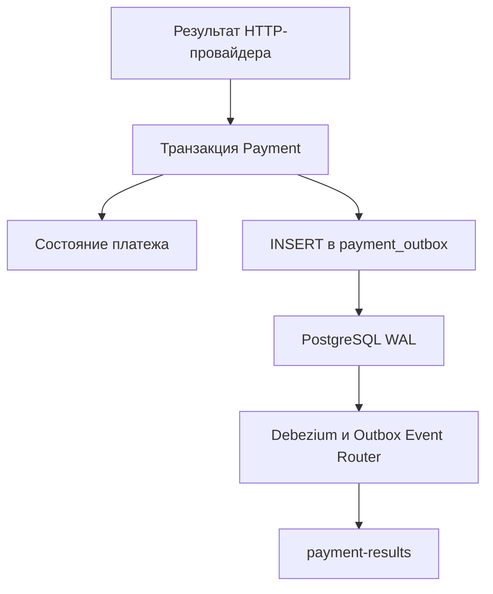

# Payment Service

Внутренний сервис оплаты и полного возврата платежей в Ticket Craft. Принимает команды через Kafka, вызывает внешнего HTTP-провайдера и сохраняет результаты через Transactional Outbox. Доставку результатов в Kafka выполняет Debezium в Kafka Connect.

Сервис находится на стадии учебного MVP. Реализованные возможности и ограничения описаны ниже.

[← Обзор проекта](../README.md)

## Технологии

Java 21, Spring Boot, Spring Kafka, Spring JDBC, PostgreSQL, Flyway, RestClient, Kafka Connect, Debezium, Micrometer, Prometheus и OpenTelemetry.

Клиентского бизнес REST API нет. HTTP-порт используется для Actuator.

## Kafka-контракт

| Назначение | Топик по умолчанию | Сообщения |
|---|---|---|
| Запрос оплаты | `payment-requests` | `PaymentRequestedEvent` |
| Команда возврата | `payment-commands` | `RefundPaymentCommand` |
| Результаты | `payment-results` | `PaymentSucceededEvent`, `PaymentFailedEvent`, `PaymentRefundedEvent` |
| Ошибки оплаты | `payment-requests.DLT` | Необработанные сообщения |
| Ошибки возврата | `payment-commands.DLT` | Необработанные сообщения |

Входящие топики и DLT настраиваются через `ticketcraft.kafka`.

Исходящий топик `payment-results` задан в конфигурации коннектора [payment-outbox.json](../docker/kafka-connect/payment-outbox.json). При его изменении необходимо согласовать настройки коннектора, создания топиков и consumers.

## Обработка оплаты

1. Проверяется корректность входящей команды.
2. По `orderId` находится или создаётся платёж.
3. Для существующего платежа проверяется совпадение пользователя и суммы.
4. Если платёж находится в `PENDING`, вызывается провайдер.
5. Подтверждённый результат сохраняется вместе с outbox-событием в одной локальной транзакции.
6. После успешной обработки consumer подтверждает Kafka-сообщение.

Внешний HTTP-вызов выполняется за пределами транзакции БД.

Основные переходы состояния:

| Переход | Причина |
|---|---|
| `PENDING → SUCCEEDED` | Провайдер подтвердил списание |
| `PENDING → FAILED` | Провайдер подтвердил бизнес-отказ |
| `SUCCEEDED → REFUNDED` | Провайдер подтвердил полный возврат |

Повторная команда оплаты для `SUCCEEDED` или `FAILED` не вызывает
повторное списание. Для `PENDING` допускается повторное обращение
с тем же ключом идемпотентности.

Оплата уже возвращённого платежа отклоняется.

## Возврат

Поддерживается полный возврат успешного платежа.

Перед вызовом провайдера проверяются принадлежность платежа заказу
и совпадение суммы. Повторная команда для `REFUNDED`
не вызывает новый HTTP-запрос возврата.

Если провайдер не подтвердил возврат, платёж не становится `REFUNDED`,
а `PaymentRefundedEvent` не создаётся. Ошибка передаётся механизму retry/DLT.

## Валидация

До обращения к БД и провайдеру проверяются:

- непустой `messageId` длиной не более 128 символов;
- положительный `orderId`;
- положительный `userId` для оплаты;
- наличие `paymentId`, причины и времени события для возврата;
- наличие времени создания команды оплаты;
- положительная сумма, точно представимая с двумя знаками после запятой
  и помещающаяся в `NUMERIC(19, 2)`.

Например, `100.000` допускается, а `100.001` отклоняется.
Валидация не округляет сумму.

База дополнительно запрещает неположительные суммы через CHECK constraint.

## HTTP-провайдер и восстановление результата

Базовый адрес по умолчанию — `http://localhost:8090`.

| Операция | Метод и путь | Idempotency-Key |
|---|---|---|
| Списание | `POST /api/v1/payments/charges` | `paymentId` |
| Возврат | `POST /api/v1/payments/refunds` | `paymentId:refund` |
| Статус списания | `GET /api/v1/payments/charges/status` | Ключ списания |
| Статус возврата | `GET /api/v1/payments/refunds/status` | Ключ возврата |

Адрес и пути настраиваются через `ticketcraft.payment.provider`.

Ожидаемый ответ провайдера содержит `status`:
`APPROVED` или `DECLINED`, а также необязательный `reason`.

При сетевой ошибке, таймауте, HTTP 5xx или 429 во время POST
выполняется один GET статуса с тем же ключом.

- Найденный результат обрабатывается обычным способом.
- `404` означает отсутствие доступного результата, а не отказ в оплате.
- Ошибка или некорректный ответ status API не превращаются в бизнес-отказ:
  исходная ошибка POST передаётся вызывающему коду.
- Ошибка GET сохраняется как suppressed exception исходной ошибки POST.
- При других HTTP 4xx автоматическая сверка не выполняется.

В рамках одной попытки адаптер не повторяет POST после его ошибки.
Повторный POST возможен при повторной обработке Kafka-команды.

Защита от повторного финансового действия зависит от того,
что провайдер действительно обеспечивает идемпотентность по ключу.
Само наличие заголовка такой гарантии не создаёт.

## Retry и DLT

Для обычных повторяемых ошибок по умолчанию предусмотрены
3 попытки обработки: первая попытка и 2 повтора с задержкой 1 секунда.

Ошибки валидации `IllegalArgumentException` не повторяются.
Ошибки десериализации обрабатываются через `ErrorHandlingDeserializer`.

DLT producer поддерживает:

- JSON-события при ошибках обработки;
- исходные байты при ошибках десериализации.

После исчерпания повторов сообщение направляется в соответствующий DLT.
Сам факт попадания в DLT не означает успешного завершения оплаты
или возврата.

## Transactional Outbox и CDC

Изменение состояния платежа и запись исходящего события выполняются в одной транзакции PostgreSQL.

Публикацию выполняет Debezium PostgreSQL Connector, работающий в Kafka Connect.

CDC — Change Data Capture, захват изменений данных.



### Порядок доставки

1. Сервис получает подтверждённый результат операции провайдера.
2. В одной транзакции сохраняет состояние платежа и outbox-событие.
3. Debezium читает зафиксированную вставку из WAL PostgreSQL.
4. Outbox Event Router формирует сообщение для `payment-results`.
5. Kafka Connect сохраняет позицию обработки в offsets topic.

При rollback транзакции исходящее событие не публикуется.

Внешний HTTP-вызов не является частью транзакции PostgreSQL. Сбой после выполнения операции провайдером, но до сохранения результата требует повторной обработки с тем же ключом идемпотентности.

### Структура outbox

| Колонка | Назначение |
|---|---|
| `id` | UUID outbox-записи |
| `message_id` | Идентификатор события; защищён уникальным ограничением |
| `order_id` | Идентификатор заказа; используется как Kafka key |
| `event_type` | Логический тип результата |
| `payload` | JSONB с результатом |
| `created_at` | Время создания записи |

Повторная вставка с тем же `message_id` не создаёт новую запись. Содержимое повторного события не сравнивается с исходным.

### Коннектор

Файл: [payment-outbox.json](../docker/kafka-connect/payment-outbox.json).

| Параметр | Значение |
|---|---|
| Имя | `payment-outbox` |
| Debezium | `3.3.2.Final` |
| Максимальное число tasks | `1` |
| PostgreSQL внутри Docker | `postgres-payment:5432` |
| База | `payment_db` |
| Таблица | `public.payment_outbox` |
| Logical decoding plugin | `pgoutput` |
| Replication slot | `ticketcraft_payment_outbox` |
| Publication | `ticketcraft_payment_outbox_publication` |
| Snapshot mode | `no_data` |
| REST API Connect с хоста | `http://localhost:8085` |

Изменение файла не обновляет работающий коннектор автоматически: конфигурация применяется через Kafka Connect REST API.

### Формат сообщения

- Топик — `payment-results`.
- Key — строковое представление `order_id`.
- Value — JSON из `payload`, без CDC-envelope.
- Header `__TypeId__` — значение `event_type`.
- Header `id` — UUID строки outbox.

Order использует следующие type mappings:

| Header `__TypeId__` | DTO |
|---|---|
| `PaymentSucceededEvent` | `PaymentSucceededEvent` |
| `PaymentFailedEvent` | `PaymentFailedEvent` |
| `PaymentRefundedEvent` | `PaymentRefundedEvent` |

UUID строки outbox и `messageId` внутри события — разные идентификаторы. Бизнес-дедупликация результатов в Order использует `messageId`.

### Гарантии и восстановление

Доставка имеет семантику at-least-once.

Если сообщение доставлено в Kafka, но source offset ещё не сохранён, после восстановления возможна повторная доставка. Получатели должны поддерживать идемпотентность.

`snapshot.mode=no_data` не публикует существующие строки путём начального сканирования таблицы.

При обычном перезапуске чтение продолжается с сохранённой позиции, если доступны offsets, replication slot и необходимый WAL.

При первом развёртывании slot должен существовать до начала обработки бизнес-команд. Записи, созданные до новой позиции захвата, не восстанавливаются автоматически из таблицы.

Потеря offsets, slot или необходимого WAL требует отдельной процедуры восстановления.

### Поведение при сбоях

| Ситуация | Поведение |
|---|---|
| Транзакция Payment откатилась | Событие не публикуется |
| Connect остановлен | Результаты сохраняются в outbox, доставка задерживается |
| Connect восстановлен | Продолжается чтение с сохранённой позиции при доступном WAL |
| Kafka недоступна | Доставка задерживается; требуется контроль task и отставания |
| Ошибка преобразования | При `errors.tolerance=none` task завершается ошибкой |
| Потеря offsets или slot | Требуется отдельное восстановление |

Остановка CDC не превращает успешную оплату в бизнес-отказ. Order может оставаться в ожидании результата.

Ошибки CDC-доставки не направляются автоматически в DLT входящих команд Payment.

Автоматическая очистка outbox пока не реализована.

## Основные настройки

Значения для конфигурации по умолчанию:

| Параметр | Значение |
|---|---|
| HTTP-порт | `8084` |
| БД | `payment_db` |
| PostgreSQL с хоста | `localhost:5435` |
| Kafka с хоста в профиле local | `localhost:9092` |
| HTTP connect timeout провайдера | `2s` |
| HTTP read timeout провайдера | `5s` |
| `spring.kafka.consumer.max-poll-records` | `10` |
| `max.poll.interval.ms` | `300000` |
| `ticketcraft.kafka.concurrency` | `1` |
| `ticketcraft.kafka.poll-timeout` | `1s` |

Размер Kafka poll ограничен с учётом блокирующих обращений к провайдеру. Это не является гарантией производительности: время работы БД, провайдера и обработки ошибок также влияет на бюджет обработки.

Профиль по умолчанию — `local`.
Профиль `prod` требует переменные подключения и использует другие значения concurrency, partitions и replicas.

Настройки outbox и retry представлены immutable records с проверками в конструкторах.

Полный список настроек: `src/main/resources/application*.yml`.
Миграции: `src/main/resources/db/migration`.

## Наблюдаемость

Доступны Actuator endpoints `health`, `info`, `prometheus`, метрики приложения и распределённая трассировка.

Состояние CDC проверяется отдельно:

```powershell
Invoke-RestMethod `
    -Uri "http://localhost:8085/connectors/payment-outbox/status" |
    ConvertTo-Json -Depth 10
```

У connector и task ожидается `RUNNING`. Этот статус не доказывает отсутствие отставания доставки.

Экспорт метрик Connect/Debezium в Prometheus и CDC-панели пока не настроены.

Адрес OTLP по умолчанию:

```text
http://localhost:4318/v1/traces
```

В тестовом профиле OTLP-экспорт отключён.

Trace context автоматически не сохраняется в durable outbox. Непрерывная трасса через CDC сейчас не гарантируется.

## Запуск

Нужны Java 21, PostgreSQL с logical replication, Kafka и Kafka Connect с Debezium PostgreSQL Connector.

Для выполнения оплаты необходим совместимый payment provider. Docker Compose проекта не запускает внешний провайдер.

### Первое развёртывание

До начала обработки бизнес-команд необходимо:

1. Запустить инфраструктуру:

   ```powershell
   docker compose up -d
   ```

2. Применить Flyway-миграции Payment.
3. Зарегистрировать `payment-outbox`, подставив учётные данные.
4. Проверить `RUNNING` у connector/task и активный replication slot.
5. Разрешить обработку команд оплаты и возврата.

Если миграции применяются запуском приложения, до готовности коннектора необходимо исключить обработку бизнес-команд. При накопленных Kafka-сообщениях требуется отдельный запуск без consumers либо применение миграций отдельно.

Автоматизированный bootstrap схемы и коннектора не реализован.

### Обычный запуск

Для уже зарегистрированного коннектора с сохранёнными offsets и slot:

```powershell
docker compose up -d
.\mvnw.cmd -pl payment-service -am install -DskipTests
.\mvnw.cmd -pl payment-service spring-boot:run
```

Повторная регистрация коннектора при каждом запуске не требуется.

## Ограничения и backlog

- Фоновая сверка неопределённых операций не реализована. После исчерпания Kafka retries требуется разбор DLT и контролируемая повторная обработка.
- Не реализованы частичные возвраты.
- Тесты отклонения некорректных настроек при запуске Spring отложены в backlog.
- Проверка бюджета Kafka poll при накопленной очереди и медленном провайдере отложена в backlog.
- Проверить возврат через Debezium и обработку `PaymentRefundedEvent` в Order.
- Добавить CDC integration tests для доставки и восстановления.
- Настроить метрики CDC lag, FAILED task и удерживаемого WAL.
- Подготовить восстановление после потери offsets, slot или WAL.
- Определить безопасную очистку истории outbox.
- Автоматизировать первоначальное развёртывание схемы и коннектора.